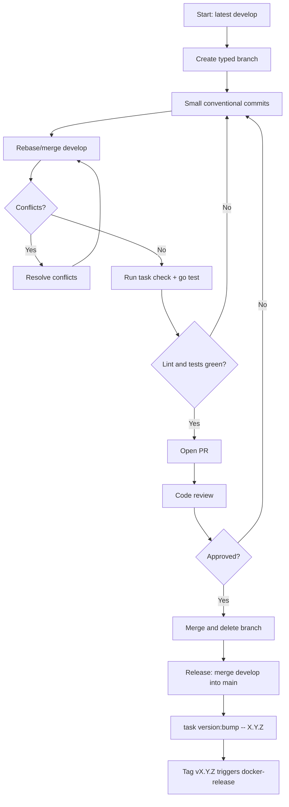

# Branching Strategy & Development Workflow

<CRITICAL_REQUIREMENT type="MANDATORY">
AI assistants MUST work on a short-lived branch and land changes through a pull request. Direct pushes to `main` are not allowed.
</CRITICAL_REQUIREMENT>

**Core Principles:**

- **Two long-lived branches**: `develop` is the integration branch, `main` is the stable/release branch.
- **Small, focused commits**: prefer several small commits over one large one.
- **Pull request mandatory**: every change lands through a PR, however small.
- **Green before merge**: lint and tests pass before review is requested.

**Workflow Requirements:**

1. **Branch Creation**: branch off `develop` (`git switch -c fix/pwa-fallback develop`).
2. **Development**: small commits with Conventional Commit subjects.
3. **Sync**: rebase or merge `develop` into the branch to stay current; resolve conflicts on the branch.
4. **Review**: open the PR against `develop` (or `main` for a release merge), describe the change and its motivation.
5. **Approval**: at least one approval before merging.
6. **Cleanup**: delete the feature branch after the merge.

<WORKFLOW_ENFORCEMENT>

- Keep branches short-lived (days, not weeks) and focused on one change.
- PR size: target ≤ 400 changed lines; split otherwise.
- Review requirement: at least 1 human approval.
- CI (`.github/workflows/tests.yml`) runs on pushes and pull requests targeting `develop` and `main`; `coverage.yml` measures both but only publishes the report and badge from `main`. A local `task lint` + `go test ./...` is still mandatory before requesting review.
- Releases: merge `develop` into `main`, then `task version:bump -- X.Y.Z` (see below).

</WORKFLOW_ENFORCEMENT>

<!--
NAMING CONVENTIONS SUBSECTION
PURPOSE: Enforce consistent branch and PR naming across all AI interactions
WHAT: Mandatory naming patterns with specific type prefixes and formats
HOW: XML <NAMING_REQUIREMENTS> with pattern examples and counter-examples
REINFORCEMENT TECHNIQUES:
1. XML enforcement tags for machine parsing
2. Code block syntax highlighting for patterns
3. Visual checkmarks (✅/❌) for immediate pattern recognition
4. Concrete examples with explanations
5. Clear mapping between branch names and PR titles
DESIGN RATIONALE: Pattern recognition through visual cues and strict typing
-->

## Branch and Pull Request Naming Conventions

<NAMING_REQUIREMENTS type="MANDATORY">
AI assistants MUST use these exact naming patterns for branches and pull requests.
</NAMING_REQUIREMENTS>

**Branch Naming Pattern:**

```text
<type>/<brief-description>
```

**Required Types:**

- `feature/` - New features or enhancements
- `fix/` - Bug fixes and hotfixes
- `docs/` - Documentation updates
- `refactor/` - Code refactoring without functional changes
- `test/` - Test additions or modifications
- `chore/` - Maintenance tasks (dependencies, build scripts, version bumps)
- `plan/` - Planning artifacts and proposals

**Examples:**

- ✅ `feature/action-links`
- ✅ `fix/pwa-ui-fallback`
- ✅ `docs/update-api-documentation`
- ✅ `refactor/extract-config-defaults`
- ❌ `my-branch` (no type prefix)
- ❌ `feature/very-long-description-that-is-hard-to-read` (too verbose)

**Pull Request Naming:**

- PR titles use the same Conventional Commit style as the commit subject
- Use imperative mood, lowercase type prefix
- Examples:

  - Branch: `feature/action-links` → PR: `feat: add action links to homepage`
  - Branch: `fix/pwa-ui-fallback` → PR: `fix: serve index.html when the PWA route misses`

<!--
COMMIT MESSAGE CONVENTIONS SUBSECTION
PURPOSE: Standardize commit formatting for automated tooling and clarity
WHAT: Conventional commit specification with imperative mood requirements
HOW: XML <COMMIT_REQUIREMENTS> with format templates and validation rules
REINFORCEMENT TECHNIQUES:
1. Template-based format specification with placeholders
2. Imperative mood enforcement through bold text emphasis
3. Type categorization with semantic meaning
4. Multi-line examples showing complete commit structure
5. Negative examples with explicit rejection criteria
DESIGN RATIONALE: Structured format enables automation and consistent history
-->

## Commit Message Conventions

<COMMIT_REQUIREMENTS type="MANDATORY">
AI assistants MUST follow these commit message conventions for all commits.
</COMMIT_REQUIREMENTS>

**Format Requirements:**

```text
<type>: <subject>

[optional body]

[optional footer]
```

**Subject Line Rules:**

- Use **imperative mood** ("add version bump task", not "added version bump task")
- Lowercase type prefix, no period at the end
- Keep it short and specific (the 72-character guideline is enough; do not pad it)
- The version-bump commit produced by `task version:bump` is `chore: bump to X.Y.Z` and must stay in that exact form

**Type Categories:**

- `feat:` - New features
- `fix:` - Bug fixes
- `docs:` - Documentation changes
- `style:` - Code style changes (formatting)
- `refactor:` - Code refactoring without functionality changes
- `test:` - Adding or updating tests
- `chore:` - Maintenance tasks, dependency updates, version bumps

**Examples:**

- ✅ `feat: add action links to homepage`
- ✅ `fix: keep PWA route falling back to index.html`
- ✅ `docs: document the actions configuration`
- ✅ `chore: bump to 0.0.12`
- ❌ `fix bug` (too vague)
- ❌ `Update stuff` (not descriptive)

**Body and Footer Guidelines:**

- Body: explain **what** and **why**, not **how**
- Footer: reference issues, breaking changes
- Example:

  ```text
  feat: add action links to homepage

  Render the actions defined in homepage.yaml as modal-driven buttons so
  users can trigger container operations without leaving the dashboard.

  Closes #42
  ```

<!--
BRANCH AND COMMIT PROCESS WORKFLOW SUBSECTION
PURPOSE: Define complete development lifecycle with visual process flow
WHAT: End-to-end workflow from branch creation to release with decision points
HOW: XML <PROCESS_REQUIREMENTS> combined with Mermaid flowchart visualization
REINFORCEMENT TECHNIQUES:
1. Process requirement XML tags for mandatory compliance
2. Mermaid flowchart with conditional logic and decision points
3. Sequential step numbering for pre-merge requirements
4. Bullet-point merge process rules for quick scanning
DESIGN RATIONALE: Complex workflows need both textual rules and visual flow
-->

## Branch and Commit Process Workflow

<PROCESS_REQUIREMENTS type="MANDATORY">
AI assistants MUST follow this workflow for all code changes.
</PROCESS_REQUIREMENTS>

**Pre-Merge Requirements:**

1. **Sync**: rebase or merge `develop` into the branch before opening the PR.
2. **Verification**: `task lint` (staticcheck + golangci-lint) and `go test ./...` pass locally; `task test:race` when concurrency is involved.
3. **Documentation**: update `README.md`, `docs/ARCHITECTURE.md` and the agent docs in the same PR when behaviour or configuration changes.
4. **Version**: never bump the version by hand — use `task version:bump -- X.Y.Z`.

**Merge Process:**

- Merge the PR (squash or merge commit, as the PR author prefers) and delete the branch.
- `develop` accumulates integration work; merges into `main` mark a release.
- The tag created by `task version:bump` (`vX.Y.Z`) triggers `.github/workflows/docker-release.yml` and the multi-arch image publish.


