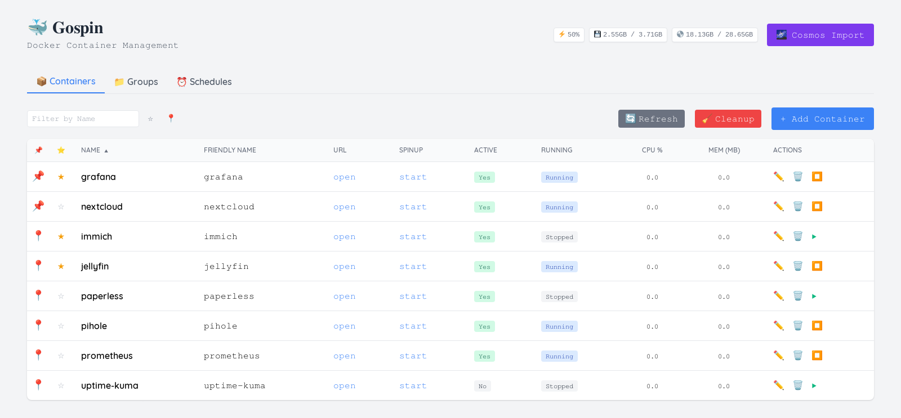
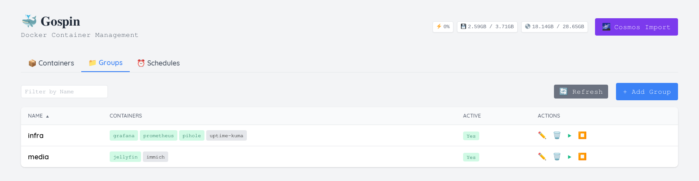
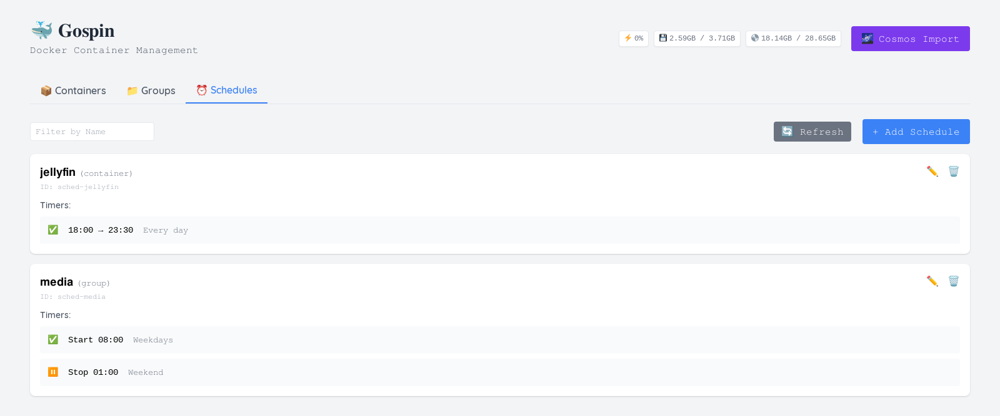
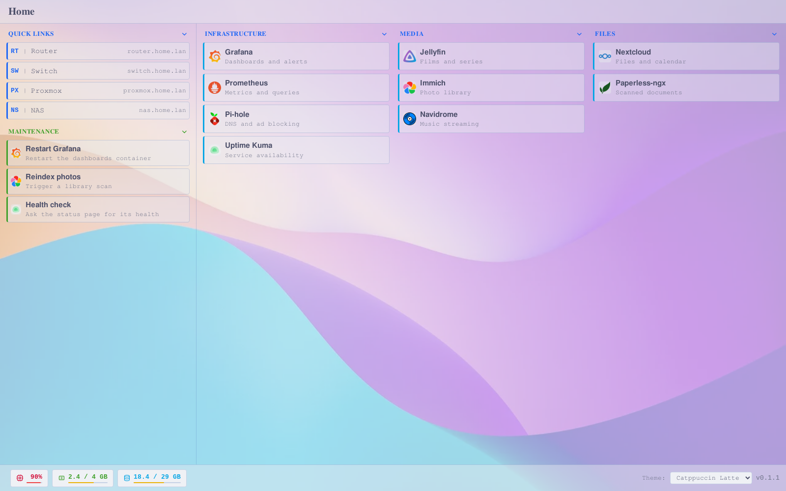
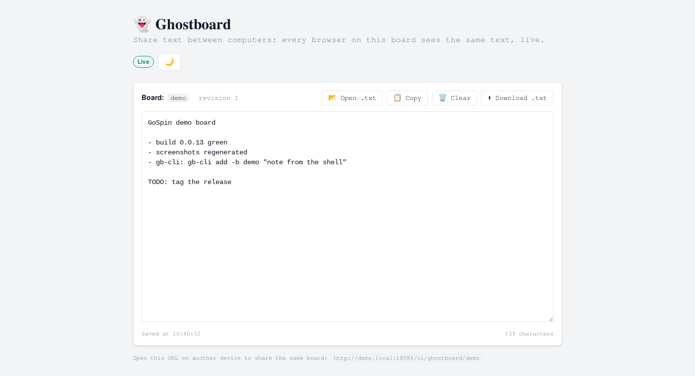

# GoSpin

[](https://github.com/asgambat/gospin/actions/workflows/tests.yml) [](https://asgambat.github.io/gospin/)

**Scheduled Docker Container Management**

GoSpin is a Go application for scheduled management of Docker containers. Define containers, groups, and schedules with timers to automatically start/stop containers based on configured times and days.

The design is inspired by [spinnerr](https://github.com/drgshub/spinnerr); GoSpin is a Go rewrite
that keeps the same scheduling model and adds container statistics, a personal homepage and an
optional [Cosmos](https://github.com/azukaar/cosmos-server) import.

## Features

- **Container management**: register Docker containers with friendly names and URLs, mark them as
  favorites or pinned, and clean up entries whose container no longer exists
- **Groups**: organize containers into logical groups for batch start/stop
- **Schedules**: several start/stop timers per target, with per-day selection and a configurable
  timezone
- **Automatic start/stop**: the polling scheduler applies the schedules, no external cron needed
- **Runtime control and live stats**: start and stop containers from the UI and watch CPU, memory
  and disk usage
- **Web UI**: dashboard for containers, groups and schedules, plus a shared ghostboard page
- **Personal homepage**: `config/homepage.yaml` drives a themed dashboard of services, bookmarks,
  server-side HTTP actions and a keyboard-driven search palette
- **Ghostboard**: one shared text board per URL path, synced over Server-Sent Events and scriptable
  with the bundled `gb-cli`
- **Cosmos import**: import the containers already defined in a Cosmos installation
- **REST API**: JSON API for containers, groups, schedules, runtime, homepage and boards
- **File watching**: reload the data file when it changes externally
- **Graceful shutdown** and configuration validation at startup

## Screenshots

Screenshots come from a demo instance with fictional containers, hosts and schedules. They are
regenerated with `task screenshots`: the script builds the server, starts it on the memory runtime
with the fixtures in `scripts/screenshots/fixtures/`, and captures the five pages with Playwright's
Chromium. Node is needed only for that task, and the browser is installed under `.build/` (ignored
by git) on first use.

The dashboard, with containers, groups and schedules:





The homepage and the shared text board:




## Quick Start

### Prerequisites

- Go 1.25.6+
- Docker
- [Task](https://taskfile.dev) — the only build front-end
- `staticcheck` and `golangci-lint` — `task build` runs `task lint` before compiling
- `air` — only for `task watch` (`task install` installs it)

Install the tooling once:

```bash
go install github.com/go-task/task/v3/cmd/task@latest
go install honnef.co/go/tools/cmd/staticcheck@2025.1.1
curl -sSfL https://raw.githubusercontent.com/golangci/golangci-lint/master/install.sh | sh -s -- -b $(go env GOPATH)/bin v1.64.8
task install   # air, used by `task watch`
```

### Installation

```bash
# Clone the repository
git clone https://github.com/asgambat/gospin.git
cd gospin

# Build (recommended — injects git tag/commit/build time into the binary)
task build            # → .build/gospin

# Or, manually with raw ldflags:
VERSION=$(git describe --tags --always --dirty 2>/dev/null || cat .version)
BUILD_TIME=$(date -u '+%Y-%m-%d_%H:%M:%S')
GIT_COMMIT=$(git rev-parse --short HEAD 2>/dev/null || echo "unknown")
GO_VERSION=$(go version | awk '{print $3}')
go build -ldflags "\
  -s -w \
  -X github.com/asgambat/gospin/internal/version.Version=$VERSION \
  -X github.com/asgambat/gospin/internal/version.BuildTime=$BUILD_TIME \
  -X github.com/asgambat/gospin/internal/version.GitCommit=$GIT_COMMIT \
  -X github.com/asgambat/gospin/internal/version.GoVersion=$GO_VERSION" \
  -o .build/gospin ./cmd/server/main.go

# Run
task run              # dev run, version metadata injected
./.build/gospin       # binary produced by `task build` or by the manual build above
```

### Build-time version metadata

The version string rendered in the bottom-right of the dashboard is **not** read from `config/homepage.yaml`. It is injected into the binary at link time via `-ldflags "-X …/internal/version.<Var>=…"` and survives every release. Four `internal/version` package variables are populated this way:

| Variable | Source (Taskfile default) | Example value |
|----------|---------------------------|---------------|
| `Version` | `git describe --tags --always --dirty` (fallback `0.1.1`) | `v1.2.3`, `v1.2.3-4-gabc1234`, `v1.2.3-dirty` |
| `BuildTime` | `date -u '+%Y-%m-%d_%H:%M:%S'` | `2026-06-22 14:30:00` |
| `GitCommit` | `git rev-parse --short HEAD` (fallback `unknown`) | `abc1234` |
| `GoVersion` | `go version \| awk '{print $3}'` | `go1.25.6` |

The same four `-X` flags are baked into `Dockerfile` via `--build-arg VERSION=… BUILD_TIME=… GIT_COMMIT=… GO_VERSION=…`, so multi-arch CI builds embed the same metadata into the published image. Version tags (`v*.*.*`) are published by `.github/workflows/docker-release.yml` to both `ghcr.io` and Docker Hub; `.github/workflows/docker_build_push.yml` handles `main` pushes, pull requests and manual runs. There is no environment variable that can override these at runtime — they are part of the compiled binary.

### Access

- **Web UI**: http://localhost:8084/ui
- **API**: http://localhost:8084/
- **Health Check**: http://localhost:8084/health

## Configuration

### Configuration File

Create `config/config.yaml`:

```yaml
server:
  port: 8084
  waiting_server_port: 8085
  shutdown_timeout_secs: 5
  read_timeout_secs: 10
  write_timeout_secs: 10
  idle_timeout_secs: 120
  request_timeout_millis: 1000   # per-request timeout applied to the API routes

data:
  file_path: ./config/data/config.json
  persist_interval_secs: 5 #how often to persist data to file
  scheduling_enabled: true       # Enable/disable automatic containers starting/stopping based on schedules
  scheduling_poll_interval_secs: 30
  base_url: "http://localhost/"  # Base URL for container URL generation, supports $1 token
  spin_up_url: "http://localhost/"  # Base URL for container lazy startup URL generation supports $1 token
  refresh_interval_secs: 60      # UI auto-refresh interval (seconds)
  stats_refresh_interval_secs: 120  # container stats refresh interval (seconds)
  system_monitor_mount_point: "/"   # mount point reported by /runtime/stats
  actions_mode: "async"             # "sync" or "async" — how actions return results to the frontend
  actions_timeout_seconds: 30       # timeout for proxied HTTP action requests

misc:
  cors_allowed_origins: "*"      # CORS origins, default "*"
  cosmos_base_url: ""            # Cosmos API base URL (e.g., "https://cosmos.example.com")
  cosmos_token: ""               # Cosmos API bearer token for authentication

ghostboard:
  file_path: ""                  # defaults to <dir of data.file_path>/ghostboard.json
  clear_delay_secs: 300          # text is kept this long after the last write or client disconnect
  max_text_bytes: 16777216       # largest decoded text per board (16 MiB); the body limit derives from it
  persist_interval_secs: 2       # interval between writes of pending changes
  heartbeat_interval_secs: 25    # SSE keep-alive comment interval
  private_boards: []             # boards that need the PIN; every other board stays public
  pin_hmac: ""                   # HMAC-SHA256 of the PIN: gb-cli pin-hash <pin>
  pin_secret: ""                 # set GO_SPIN_GHOSTBOARD_PIN_SECRET instead of writing it here
  session_ttl_secs: 28800        # how long an unlock stays valid (8 hours)
  pin_max_attempts: 5            # failed attempts per client address before a lockout
  pin_lockout_secs: 60           # first lockout; it doubles on every further batch of failures
  files_enabled: true            # attachments of a board, served at /ghostboard/:board/files
  max_file_bytes: 838860800      # largest single upload (800 MiB)
  max_file_count: 10             # files per board
  max_board_file_bytes: 2147483648  # bytes of the files of one board (2 GiB)
  max_total_file_bytes: 5368709120  # bytes of every attachment on the instance (5 GiB)
  file_ttl_secs: 86400           # hard cap on a file's life (24 hours); the idle clear can delete it earlier
  file_transfer_timeout_secs: 600   # read/write window of one upload or download (10 minutes)
```

The directory holding `data.file_path` is created at startup when it does not exist, so a fresh
clone (or a new `GO_SPIN_CONFIG_PATH`) needs no manual `mkdir` for `config/data/`.

### Environment Variables

Every setting can be overridden with an environment variable. The prefix is `GO_SPIN_` and the dots
of the configuration key become underscores, so `misc.log_level` maps to
`GO_SPIN_MISC_LOG_LEVEL`. The environment wins over the configuration file, which wins over the
built-in defaults, and the tables below name the variable of every key.

A `.env` file in the working directory is read at startup as well; variables already present in the
environment are never replaced by it. Values are validated when the process starts, so a port
outside 1-65535, a zero or negative duration, an unknown `data.actions_mode` or a timezone that
cannot be loaded stop it with the offending key in the message instead of leaving a half-configured
instance running.

#### Bootstrap

| Variable | Default | Description |
| -------- | ------- | ----------- |
| `GO_SPIN_CONFIG_PATH` | `./config` | Directory holding `config.yaml`; the default `data.file_path` resolves inside it |
| `PORT` | `8084` | Port of the main server |
| `WAITING_SERVER_PORT` | `8085` | Port of the auxiliary waiting server |

`PORT` and `WAITING_SERVER_PORT` are also accepted as `GO_SPIN_SERVER_PORT` and
`GO_SPIN_SERVER_WAITING_SERVER_PORT`; the bare form wins when both are set, which is what the
published image and `docker-compose.yml` rely on.

#### Server

| Key | Environment variable | Default |
| --- | -------------------- | ------- |
| `server.port` | `GO_SPIN_SERVER_PORT` | `8084` |
| `server.waiting_server_port` | `GO_SPIN_SERVER_WAITING_SERVER_PORT` | `8085` |
| `server.read_timeout_secs` | `GO_SPIN_SERVER_READ_TIMEOUT_SECS` | `10` |
| `server.write_timeout_secs` | `GO_SPIN_SERVER_WRITE_TIMEOUT_SECS` | `10` |
| `server.idle_timeout_secs` | `GO_SPIN_SERVER_IDLE_TIMEOUT_SECS` | `120` |
| `server.shutdown_timeout_secs` | `GO_SPIN_SERVER_SHUTDOWN_TIMEOUT_SECS` | `5` |
| `server.request_timeout_millis` | `GO_SPIN_SERVER_REQUEST_TIMEOUT_MILLIS` | `1000` |
| `server.cors_allowed_origins` | `GO_SPIN_SERVER_CORS_ALLOWED_ORIGINS` | unset |

The last row is the deprecated alias of `misc.cors_allowed_origins`: it is read only when the
canonical key is empty, and a conflicting pair is reported with a startup warning.

#### Data and persistence

| Key | Environment variable | Default |
| --- | -------------------- | ------- |
| `data.file_path` | `GO_SPIN_DATA_FILE_PATH` | `./config/data/config.json` |
| `data.persist_interval_secs` | `GO_SPIN_DATA_PERSIST_INTERVAL_SECS` | `5` |
| `data.scheduling_enabled` | `GO_SPIN_DATA_SCHEDULING_ENABLED` | `true` |
| `data.scheduling_poll_interval_secs` | `GO_SPIN_DATA_SCHEDULING_POLL_INTERVAL_SECS` | `30` |
| `data.base_url` | `GO_SPIN_DATA_BASE_URL` | `http://localhost/` |
| `data.spin_up_url` | `GO_SPIN_DATA_SPIN_UP_URL` | `http://localhost/` |
| `data.refresh_interval_secs` | `GO_SPIN_DATA_REFRESH_INTERVAL_SECS` | `60` |
| `data.stats_refresh_interval_secs` | `GO_SPIN_DATA_STATS_REFRESH_INTERVAL_SECS` | `120` |
| `data.system_monitor_mount_point` | `GO_SPIN_DATA_SYSTEM_MONITOR_MOUNT_POINT` | `/` |
| `data.actions_mode` | `GO_SPIN_DATA_ACTIONS_MODE` | `async` |
| `data.actions_timeout_seconds` | `GO_SPIN_DATA_ACTIONS_TIMEOUT_SECONDS` | `30` |

#### Misc

| Key | Environment variable | Default |
| --- | -------------------- | ------- |
| `misc.gin_mode` | `GO_SPIN_MISC_GIN_MODE` | `release` |
| `misc.scheduling_timezone` | `GO_SPIN_MISC_SCHEDULING_TIMEZONE` | `Local` |
| `misc.runtime_type` | `GO_SPIN_MISC_RUNTIME_TYPE` | `docker` |
| `misc.log_level` | `GO_SPIN_MISC_LOG_LEVEL` | `info` |
| `misc.cors_allowed_origins` | `GO_SPIN_MISC_CORS_ALLOWED_ORIGINS` | `*` |
| `misc.cosmos_base_url` | `GO_SPIN_MISC_COSMOS_BASE_URL` | empty |
| `misc.cosmos_token` | `GO_SPIN_MISC_COSMOS_TOKEN` | empty |

`misc.runtime_type` accepts `docker` or `memory`; `memory` runs the dashboard without the Docker
socket, which is how the test suite and `task screenshots` work. `misc.cosmos_token` is a secret:
keep it in the environment or an `.env` file that is not committed, never in `config/config.yaml`.

#### Ghostboard

| Key | Environment variable | Default |
| --- | -------------------- | ------- |
| `ghostboard.file_path` | `GO_SPIN_GHOSTBOARD_FILE_PATH` | `<dir of data.file_path>/ghostboard.json` |
| `ghostboard.clear_delay_secs` | `GO_SPIN_GHOSTBOARD_CLEAR_DELAY_SECS` | `300` |
| `ghostboard.max_text_bytes` | `GO_SPIN_GHOSTBOARD_MAX_TEXT_BYTES` | `16777216` |
| `ghostboard.persist_interval_secs` | `GO_SPIN_GHOSTBOARD_PERSIST_INTERVAL_SECS` | `2` |
| `ghostboard.heartbeat_interval_secs` | `GO_SPIN_GHOSTBOARD_HEARTBEAT_INTERVAL_SECS` | `25` |
| `ghostboard.private_boards` | `GO_SPIN_GHOSTBOARD_PRIVATE_BOARDS` | empty |
| `ghostboard.pin_hmac` | `GO_SPIN_GHOSTBOARD_PIN_HMAC` | empty |
| `ghostboard.pin_secret` | `GO_SPIN_GHOSTBOARD_PIN_SECRET` | empty |
| `ghostboard.session_ttl_secs` | `GO_SPIN_GHOSTBOARD_SESSION_TTL_SECS` | `28800` |
| `ghostboard.pin_max_attempts` | `GO_SPIN_GHOSTBOARD_PIN_MAX_ATTEMPTS` | `5` |
| `ghostboard.pin_lockout_secs` | `GO_SPIN_GHOSTBOARD_PIN_LOCKOUT_SECS` | `60` |
| `ghostboard.files_enabled` | `GO_SPIN_GHOSTBOARD_FILES_ENABLED` | `true` |
| `ghostboard.max_file_bytes` | `GO_SPIN_GHOSTBOARD_MAX_FILE_BYTES` | `838860800` |
| `ghostboard.max_file_count` | `GO_SPIN_GHOSTBOARD_MAX_FILE_COUNT` | `10` |
| `ghostboard.max_board_file_bytes` | `GO_SPIN_GHOSTBOARD_MAX_BOARD_FILE_BYTES` | `2147483648` |
| `ghostboard.max_total_file_bytes` | `GO_SPIN_GHOSTBOARD_MAX_TOTAL_FILE_BYTES` | `5368709120` |
| `ghostboard.file_ttl_secs` | `GO_SPIN_GHOSTBOARD_FILE_TTL_SECS` | `86400` |
| `ghostboard.file_transfer_timeout_secs` | `GO_SPIN_GHOSTBOARD_FILE_TRANSFER_TIMEOUT_SECS` | `600` |

`ghostboard.private_boards` is a list, and the environment form takes the board names **separated by
spaces**, not commas: `GO_SPIN_GHOSTBOARD_PRIVATE_BOARDS="lavoro note"`. A comma stays part of the
name and is rejected at startup as an invalid board name. The same variable cannot empty a list that
the configuration file sets, because an empty environment value is ignored; remove the key from the
file instead.

A PIN setup needs three variables and no file at all:

```bash
export GO_SPIN_GHOSTBOARD_PIN_SECRET="$(openssl rand -hex 32)"
export GO_SPIN_GHOSTBOARD_PIN_HMAC="$(gb-cli pin-hash 1234)"   # same secret in both commands
export GO_SPIN_GHOSTBOARD_PRIVATE_BOARDS="lavoro note"
```

#### Logging and error reporting

| Variable | Default | Description |
| -------- | ------- | ----------- |
| `LOG_LEVEL` | unset | Level of the process logger while the configuration is being loaded; once it is loaded the server follows `GO_SPIN_MISC_LOG_LEVEL` |
| `HONEYBADGER_API_KEY` | unset | Enables Honeybadger error reporting (recovered panics are notified); empty leaves it off |
| `GO_ENV` | unset | Environment name attached to the Honeybadger notices |

#### Container runtime

| Variable | Default | Description |
| -------- | ------- | ----------- |
| `UID` | `1000` | User id the image runs as |
| `GID` | `1000` | Group id the image runs as |

Both are `ENV` defaults of the image, meant for `docker run -e UID=$(id -u) -e GID=$(id -g)` so the
mounted `config/` stays writable by the local user.

#### `gb-cli`

The CLI has its own variables, all optional, which override its configuration file:

| Variable | Purpose |
| -------- | ------- |
| `GO_SPIN_BOARD_URL` | Server to talk to, e.g. `http://localhost:8084` |
| `GO_SPIN_BOARD_PIN` | PIN of a private board; preferred to `--pin`, which stays in the shell history and in `ps` |
| `GO_SPIN_BOARD_TIMEOUT_SECS` | Timeout of a single request |
| `GO_SPIN_BOARD_TOKEN` | Sent as `Authorization: Bearer <token>` to a board behind an authenticating proxy |
| `GO_SPIN_GHOSTBOARD_PIN_SECRET` | Secret `gb-cli pin-hash` hashes the PIN with; must be the one the server runs with |
| `XDG_CONFIG_HOME` | Where the per-user `ghostboard/config.yaml` is looked up (default `~/.config`) |
| `VISUAL`, `EDITOR` | Editor run by `gb-cli edit`, `VISUAL` first |

`gb-cli config` prints the file and the variables in use, so a mistyped name is visible instead of
silently ignored. The full reference is in [docs/CLI.md](docs/CLI.md).

### Base URL for Container Links

The `baseUrl` field is used by the Web UI to auto-generate container URLs when selecting a container name:
- If `baseUrl` is empty → `http://localhost/{name}`
- If `baseUrl` does not contain `$1` → `{baseUrl}/{name}` (removes double slashes)
- If `baseUrl` contains `$1` → replaces `$1` with the container name (e.g., `https://$1.my.domain.com` → `https://Deluge.my.domain.com`)

### Waiting Server

GoSpin can run an auxiliary "waiting" HTTP server that serves only the waiting HTML page
(spinner + redirect) used by the `/runtime/:name/waiting` endpoint while a container or group is
being started in the background. It listens on `server.waiting_server_port`
(`WAITING_SERVER_PORT`), default `8085`, and must differ from `server.port`.

## Security

### CORS Configuration

⚠️ **Production Warning**: The default CORS setting (`*`) allows all origins. For production environments, specify exact origins:

```yaml
misc:
  cors_allowed_origins: "http://localhost:3000,https://your-domain.com"
```

`misc.cors_allowed_origins` is the canonical key. The older `server.cors_allowed_origins` is
still read as a deprecated alias, but `misc.cors_allowed_origins` wins when both are set; a
conflicting pair is reported with a startup warning that names both values, so an upgrade cannot
change the allow-list silently.

### Docker Socket Security

GoSpin requires access to the Docker socket (`/var/run/docker.sock`). This grants significant privileges:

- **Development**: Use `runtime_type: memory` for testing without Docker access
- **Production**: Consider running in a restricted environment or using Docker-in-Docker
- **Container mode**: Mount Docker socket as read-only when possible
- **User Permissions**: Run GoSpin under a user with limited permissions and add it to the `docker` group. Provide userId and groupId as Environment Variables when running in Docker (UID and GID environment variables).

### File System Permissions

Ensure proper permissions for:
- Configuration directory: `config/` (read-write)
- Data file: `config/data/config.json` (read-write)

```bash
# Recommended permissions
chmod 750 config/
chmod 640 config/config.yaml
chmod 660 config/data/config.json
```

---

## Web UI

The pages are served by the Go binary: `/ui` (dashboard), `/ui/home` (the homepage driven by
`config/homepage.yaml`, and the SPA fallback for unhandled `/ui/*` paths), `/ui/ghostboard[/:board]`
(one shared board per path), the scripts and assets under `/ui/assets/**`, and `/` redirecting to
`/ui`. Those routes are the plumbing of the pages, not a public API, and their paths can change
between releases: the file-to-route map, the cache headers and the frontend rules are in
[docs/FRONTEND.md](docs/FRONTEND.md).

The page shell needs no internet access: Alpine.js 3.17.5, htmx 1.9.10 and Tailwind 2.2.19 are
vendored under `ui/assets/vendor/` and served by the binary itself, so `http://<server>:8084/ui`,
`/ui/home` and `/ui/ghostboard` load on a LAN without an uplink. The only remote fetches left are
the service icons of `homepage.yaml`, i.e. content you configure yourself.

The web interface provides visual management for:

| Tab | Features |
|-----|----------|
| **Containers** | List, Add, Edit, Delete, Start/Stop, Pin, Favorite |
| **Groups** | List, Add, Edit, Delete, Multi-select containers |
| **Schedules** | List, Add, Edit, Delete, Full timer editor with day selection and optional start/stop times |

Access the UI at `http://localhost:8084/ui`

### UI Features

- **Real-time Status**: Container running status updates automatically
- **Bulk Operations**: Select multiple containers for group operations
- **Schedule Visualization**: Visual day selector for timer configuration
- **Missing Containers Cleanup**: Preview and confirm removal of registry entries whose Docker container no longer exists
- **Ghostboard**: Per-path shared text board with live Server-Sent Events sync, dark mode, `.txt` open/copy/clear actions and `.txt` download
- **Pinned Containers**: Pinned containers stay at the top of the list, sorted alphabetically, regardless of the selected sort column; a 📌 toggle filters the list to pinned containers only
- **URL Generation**: Auto-generates container URLs based on `base_url` configuration
- **Responsive Design**: Works on desktop and mobile devices
- **Error Handling**: User-friendly error messages for failed operations

## Homepage Configuration

GoSpin ships with a personal dashboard page rendered by `ui/home.html`. Its content and appearance are driven by a separate YAML file, **`config/homepage.yaml`**, which defines three top-level sections:

- **`services`** — visual cards (name, URL, description, icon) grouped under headings
- **`bookmarks`** — short links with an optional 2-character abbreviation, grouped under headings
- **`settings`** — page-wide customization (theme, title, fonts, polling intervals)

A complete example with all three sections lives at `config/homepage.yaml` in the repository.

### `settings` reference

All `settings` fields are **optional**. If a field is omitted or left empty, the application falls back to the documented default. String-valued size fields accept any valid CSS length (e.g. `1.25rem`, `20px`, `1.1em`).

| Field | Type | Default | Description |
|-------|------|---------|-------------|
| `theme` | string | `auto` | One of `auto`, `tokyo-night`, `catppuccin-latte`, `nord`, `dracula`, `gruvbox`, `night-stars`. With `auto`, the page follows the OS `prefers-color-scheme`. An unrecognised value falls back to `auto`, so a typo never leaves the page unstyled. The on-page theme selector overrides this and persists the choice in `localStorage` under the key `homepage-theme`. |
| `title` | string | `Dashboard` | Plain-text title rendered as the page `<h1>`. |
| `title_font_size` | CSS size | `1.25rem` | Font-size of the title (e.g. `1.5rem`, `20px`, `1.1em`). Exposed at runtime as the CSS custom property `--title-font-size`. |
| `font_family` | CSS font stack | `Inter, system-ui, -apple-system, BlinkMacSystemFont, 'Segoe UI', Roboto, sans-serif` | Page-wide font family. |
| `font_size` | CSS size | `17px` | Document-wide base font size; drives Tailwind rem-derived scaling. |
| `polling_interval_seconds` | int | `10` | How often the page polls `/homepage` to detect external config-file changes (in seconds). |
| `stats_polling_interval_seconds` | int | `3` | How often the page polls `/runtime/system-stats` to refresh CPU/RAM/Disk in the footer. |

### Example

```yaml
settings:
  theme: catppuccin-latte
  title: My Dashboard
  title_font_size: "1.5rem"
  font_family: "Inter, system-ui, -apple-system, BlinkMacSystemFont, 'Segoe UI', Roboto, sans-serif"
  font_size: "19px"
  polling_interval_seconds: 10
  stats_polling_interval_seconds: 3
```

### Available themes

Six named themes are available, plus `auto` which delegates to one of the dark/light themes based on the OS `prefers-color-scheme`:

| Theme           | Description                                                                  | Background image    | Translucent cards |
|-----------------|------------------------------------------------------------------------------|---------------------|-------------------|
| `tokyo-night`   | Dark blue Tokyo Night palette.                                               | —                   | No                |
| `catppuccin-latte` | Light Catppuccin Latte palette.                                            | Yes (locally hosted) | Yes               |
| `nord`          | Cool Nord palette (arctic, muted).                                           | Yes (locally hosted) | Yes               |
| `dracula`       | Classic Dracula palette (purple accents).                                    | —                   | No                |
| `gruvbox`       | Warm Gruvbox retro palette.                                                  | —                   | No                |
| `night-stars`   | Dark Dracula-inspired palette with a starry-night background image and translucent cards. | Yes (locally hosted) | Yes               |

Themes with a background image render it through a themed `body.<theme>::before` pseudo-element (with a per-theme `filter` and `opacity`) layered between the page background and the content. Background images are stored locally under `ui/assets/themes/<theme>-bg.jpg` (where `<theme>` is one of `nord`, `catppuccin-latte`, or `night-stars`) and served by the static asset router at `/ui/assets/themes/...`; **no third-party requests are made at runtime**, so the dashboard works offline and in air-gapped environments.

### Local theme assets

The three "glassmorphism" themes (`nord`, `catppuccin-latte`, `night-stars`) each ship with their own background image. To avoid leaking visitor activity to a third-party CDN and to keep the dashboard working in air-gapped / privacy-strict environments, these images are bundled with the repository and served by the Go server itself — **no third-party image fetches happen on the homepage at runtime**.

- **Directory**: [`ui/assets/themes/`](ui/assets/themes/) holds the source JPEGs (progressive, 2560px wide, ≈ 80% quality):
  - `nord-bg.jpg` — 2560×1707, ≈ 723 KB
  - `catppuccin-latte-bg.jpg` — 2560×1945, ≈ 308 KB
  - `night-stars-bg.jpg` — 2560×1628, ≈ 738 KB
- **Routing**: the static route `r.Static("/ui/assets", "./ui/assets")` defined in [`internal/api/route/ui_route.go`](internal/api/route/ui_route.go) registers every file in `ui/assets/` at the URL prefix `/ui/assets/...`. The CSS in [`ui/home.html`](ui/home.html) therefore references absolute paths like `url('/ui/assets/themes/nord-bg.jpg')`; the Gin router serves the bytes directly off disk with no extra middleware.
- **Total payload**: ≈ 3.29 MB (3,286,933 B) across all 12 files (3 themes × 4 variants: 2560 px JPEG, 1280 px JPEG, 2560 px WebP, 1280 px WebP). The browser fetches only the variant it needs per theme switch (via `image-set()`); the service worker pre-caches all variants for offline use.
- **Replacing an image**: drop a new JPEG with the same filename into `ui/assets/themes/` and restart the server (or hot-reload if your deployment supports it). No CSS change required.

### Search modal

The dashboard also exposes a keyboard-driven search palette — a Spotlight/VS Code-style overlay that jumps directly to any service or bookmark without scrolling.

**Trigger keys** (only when focus is not in an `INPUT`, `TEXTAREA`, `SELECT`, or contenteditable element, and no `Ctrl` / `Cmd` / `Alt` modifier is held):

- **Press `Enter`** — opens the modal with an empty query; results appear as you type.
- **Press any single alphanumeric key** (`a`–`z`, `A`–`Z`, `0`–`9`) — opens the modal **and** seeds the query with that character; subsequent typing refines the filter.

**Inside the modal**:

- **Result list** shows up to **6 matches**, real-time filtered across every service and bookmark currently rendered. Matches are weighted by relevance (exact name > name prefix > name substring > abbreviation match > description match) and ties are broken alphabetically by name.
- **Each result** displays the service/bookmark icon (`` with an abbr/first-two-letter monogram fallback), the name, the description, and the source group label.
- **Keyboard shortcuts** (also rendered in the modal's hint footer):
  - `↑` / `↓` — move the selection up/down
  - `↵` (Enter) — open the highlighted result in a new tab and close the modal
  - `Esc` — close the modal without navigating; focus returns to the page so the next `Enter` re-opens it
  - `Tab` — native browser focus order (cycles input → results)
- **Mouse** — clicking a result activates it the same way `Enter` does; hovering a row updates the keyboard selection so the next `Enter` opens that row.

The modal's source of truth is the same `data.services` + `data.bookmarks` already loaded on the page; an in-memory index is rebuilt every time the homepage config is hot-reloaded, so newly added services show up in search without a manual refresh.

Accessibility: the modal uses `role="dialog"` + `aria-modal="true"` + `aria-label="Search services and bookmarks"`, and each result carries `role="option"` with `aria-selected` reflecting the keyboard position.

### Actions Configuration

GoSpin supports configurable HTTP action buttons on the homepage dashboard. Actions execute HTTP requests **server-side** (the browser never sees headers, tokens, or request bodies).

Two files work together:

| File | Purpose |
|------|---------|
| `config/homepage.yaml` → `actions:` section | Visual definition: name, icon, description, and a **reference key** |
| `config/actions.yml` | Technical definition: HTTP method, target URL, headers, and body |

`config/actions.yml` is optional. When it is missing or defines no action, the dashboard simply has
no action buttons and the startup dangling-reference check is skipped instead of warning about every
reference in `homepage.yaml`.

#### `config/actions.yml` — Technical configuration (server-side only)

```yaml
actions:
  avvia-firefox:
    method: POST
    url: "https://api.example.com/container/start"
    headers:
      Authorization: "Bearer xxx-secret-token"
      Content-Type: "application/json"
    body: '{"container": "jlesage-firefox"}'

  ping-gospin:
    method: GET
    url: "https://gospin.lan.asga.uk/health"
```

#### `config/homepage.yaml` → `actions:` section

```yaml
actions:
  - group: Controlli
    items:
      - name: Avvia Firefox
        action: avvia-firefox          # references actions.yml
        icon: firefox.png
        description: Avvia il container Firefox
```

#### Execution modes

Configured via `data.actions_mode` in `config/config.yaml`:

| Mode | Server returns | Modal shows |
|------|---------------|-------------|
| `sync` | `{mode, statusCode, body}` | Status code + response body (up to 1 MB) |
| `async` (default) | `{mode, statusCode}` | ✅ OK (2xx) or ❌ KO (otherwise) |

The action timeout is configured globally via `data.actions_timeout_seconds` (default: 30s).

#### Responses and errors

Every response is JSON and carries `mode` (`sync` or `async`), errors included, so the frontend
never has to infer the layout from the presence of a body.

| Status | Cause | Body |
| --- | --- | --- |
| `200` | The target answered. Its own status is reported in `statusCode`, so a target `500` is still an HTTP `200` here. | `{mode, statusCode, body?}` |
| `400` | `actionName` missing/empty, or a request body that is not valid JSON. | `{error, mode}` |
| `404` | `actionName` is not defined in `actions.yml`, including when the file does not exist: it is optional and then yields an empty action set. | `{error, mode}` |
| `500` | `actions.yml` exists but cannot be used: invalid YAML, an action without `method` or `url`, or a URL whose scheme is not `http`/`https`. The file is re-read on the next request, so fixing it needs no restart. | `{error, mode}` |
| `502` | The outbound request failed: unreachable host, connection refused, TLS error, or the action exceeded `data.actions_timeout_seconds`. | `{error, mode}` |

In `sync` mode the target's body is read up to 1 MB and the rest is dropped: the response is
returned truncated and carries no truncation flag. `async` mode never reads the target body.
The route is also wrapped by the generic request-timeout middleware, which can answer
`504 {"error": "request timeout"}` without `mode` if a handler finishes after the deadline
without writing anything; the action controller normally writes the `502` itself first.

#### Security

- Headers, tokens, and request bodies are stored in `actions.yml` **on the server only** and are **never** exposed to the browser
- The browser sends only an action reference name (e.g. `"actionName": "avvia-firefox"`)
- The Go backend proxies the HTTP request server-side, eliminating CORS concerns
- Body responses are capped at 1 MB in sync mode to prevent memory exhaustion

> **Note on search:** Action buttons are intentionally **excluded** from the homepage search index. Actions trigger server-side HTTP requests rather than navigating to a URL, so they are not searchable links like services and bookmarks. The search modal indexes only `services` and `bookmarks`.

### Notes

- The `/homepage` response never contains `null` for `services`, `bookmarks`, `actions` or for the
  `items` of a group: missing sections and lists are normalized to empty arrays, so the Alpine
  `x-for` templates can iterate before a section is configured.
- The open/closed state of the accordion groups is persisted in `localStorage` under the key
  `homepage-collapsed-groups`.
- The file is **hot-reloaded**: when the content-hash on the `/homepage` response changes, the page re-fetches and re-applies all visuals (theme, fonts, layout) without a full reload.
- The **build metadata** rendered in the bottom-right of the page (e.g. `v1.2.3 · abc1234`) is **not** a YAML field. It is sourced from four `internal/version.*` package vars at build time and exposed as top-level JSON fields on the `/homepage` response (`version`, `buildTime`, `gitCommit`, `goVersion`).
  - `task build` injects them via `-ldflags` from `git describe`, `date`, `git rev-parse`, and `go version`.
  - The Dockerfile injects the same four flags via `--build-arg` so the published image carries the metadata.
  - Users cannot override them via `homepage.yaml` — the server value always wins (a test pins this invariant: even a YAML `version: …` key is silently ignored).

## API Endpoints

### Health
| Method | Endpoint | Description |
|--------|----------|-------------|
| GET | `/health` | Health check |

### Containers
| Method | Endpoint | Description |
|--------|----------|-------------|
| GET | `/containers` | List all containers |
| GET | `/container/:name/ready` | Readiness probe polled by the waiting page; answers `{"ready": true|false}` |
| GET | `/containers/orphans` | Preview registry containers missing from the runtime |
| POST | `/containers/orphans/remove` | Remove the confirmed missing containers |
| POST | `/containers/import` | Import containers from Cosmos API |
| POST | `/container` | Create/update container |
| DELETE | `/container/:name` | Delete container |

#### Cleaning up missing containers

When a container is removed outside GoSpin (for example `docker rm`), its registry entry stays
behind. The **Cleanup** button in the Containers tab runs a check against the container runtime
(`docker ps -a` through the Docker SDK) and shows the entries that no longer exist:

1. `GET /containers/orphans` returns the candidates and **deletes nothing**. It compares the
   registry with `ListContainers` of the runtime, so stopped containers still count as existing.
2. The UI lists them in a confirmation modal. **Cancel** discards the list and nothing is removed.
3. `POST /containers/orphans/remove` with `{"names":["a","b"]}` performs the deletion. Every
   name is re-checked against the runtime first: containers that reappeared (or are not in the
   registry) are reported under `skipped` instead of being deleted. The response is
   `{"removed":[...],"skipped":[...]}`.

Removing a container also deletes the schedules that target it and drops its references from
groups. A runtime failure returns `500` and leaves the registry untouched. With
`misc.runtime_type: memory` the runtime has no container daemon and mirrors the registry, so no
container is ever reported as missing.

#### Pinning containers

A container can be pinned with the 📌 toggle in the Containers tab (or the **Pin to top**
checkbox of the edit form). The flag is stored in the registry as the optional boolean
`pinned` field of `POST /container`:

```json
{"name":"nginx","friendly_name":"Nginx","url":"http://nginx.local","active":true,"running":false,"favorite":false,"pinned":true}
```

Pinned containers are always listed before the others and sorted alphabetically by name,
whatever the selected sort column and direction; the remaining containers keep the chosen
sort. The 📌 button next to the name filter restricts the list to pinned containers and can
be combined with the “favorites only” filter, while the container details modal shows the
current pin state. Both filter toggles are persisted in `localStorage` under the key
`gosspin.containerFilters` (a `{"favoritesOnly":bool,"pinnedOnly":bool}` object) and
restored on page load, so they survive a reload; if storage is unavailable the filters
simply start disabled. Pinning is independent from `favorite`, which only drives the
“favorites only” filter. Clients that omit `pinned` on an update reset it to `false`, so a
full container payload is required to preserve the flag.

### Groups
| Method | Endpoint | Description |
|--------|----------|-------------|
| GET | `/groups` | List all groups |
| POST | `/group` | Create/update group |
| DELETE | `/group/:name` | Delete group |

### Schedules
| Method | Endpoint | Description |
|--------|----------|-------------|
| GET | `/schedules` | List all schedules |
| POST | `/schedule` | Create/update schedule |
| DELETE | `/schedule/:id` | Delete schedule |

#### Timer semantics

Each timer is `{startTime, stopTime, days, active}`. `startTime` and `stopTime` are both
optional, but **at least one of them must be set** (otherwise the API answers `400` with
`timer <n> must define startTime, stopTime or both`). `active` is required: a timer without it
is rejected with `400`, because a stored timer always has an explicit state (absent would mean
"active" to the scheduler and "inactive" after a reload of the data file). Times use `HH:MM`.

| Timer | Behaviour |
|-------|-----------|
| `startTime` + `stopTime` | Window: the target is started at `startTime` and stopped at `stopTime` (a window crossing midnight is supported, e.g. `22:00` → `06:00`). |
| `startTime` only | The target is started at `startTime` on the selected days and left running; nothing stops it automatically until a stop-only timer or a manual stop. |
| `stopTime` only | The target is stopped at `stopTime` on the selected days, even if GoSpin did not start it (e.g. a container started manually). |

A start-only timer keeps the target up until midnight, so a stop-only timer that is due the same
day overrides it: the explicit stop wins and the container is not restarted until the next day.
A start+stop window that contains the current time always wins over a stop-only timer, since the
window declares its own end.

`days` uses `0`=Sunday ... `6`=Saturday; a timer with an empty `days` array never fires. At most
one start and one stop are attempted per container per day.

The schedule target must already exist: `POST /schedule` returns `400` with
`target container "<name>" not found` (or `target group "<name>" not found`) when it does not,
because the data file loader prunes schedules whose target is missing. Deleting a container or a
group automatically deletes the schedules that target it.

### Runtime Control
| Method | Endpoint | Description |
|--------|----------|-------------|
| GET | `/runtime/:name/status` | Check if container is running |
| POST | `/runtime/:name/start` | Start container |
| POST | `/runtime/:name/stop` | Stop container |
| GET | `/runtime/:name/waiting` | Serve waiting HTML page for a container or group (starts if not running) |
| GET | `/start/:name` | Lazy spin-up entry point generated from `data.spin_up_url`; serves the same waiting page |
| POST | `/group/:name/start` | Start every container of a group |
| POST | `/group/:name/stop` | Stop every container of a group |
| GET | `/runtime/containers` | Names of the containers the runtime reports, used by the dashboard |
| GET | `/runtime/stats` | Per-container CPU and memory stats (dashboard tables) |
| GET | `/runtime/system-stats` | Host CPU, memory and disk stats (dashboard and homepage footer) |

`/runtime/:name/waiting` renders `ui/templates/waiting.html` (spinner + JavaScript redirect) with
`{{CONTAINER_NAME}}` and `{{REDIRECT_URL}}` replaced, and starts the target in the background when
it is not running. It answers `404` when the container or group does not exist, `403` when it
exists but is not active, and `200` otherwise.

### Configuration
| Method | Endpoint | Description |
|--------|----------|-------------|
| GET | `/configuration` | Get application configuration for frontend |


### Homepage
| Method | Endpoint | Description |
|--------|----------|-------------|
| GET | `/homepage` | Get homepage configuration (services, bookmarks, actions, settings) |
| POST | `/homepage/action` | Execute a named HTTP action via server-side proxy. Body: `{"actionName": "..."}`. Responses: `200`/`400`/`404`/`500`/`502`, all JSON with `mode` (see [Responses and errors](#responses-and-errors)) |

Sections missing from `homepage.yaml` are returned as empty arrays (`services: []`, `bookmarks: []`,
`actions: []`) instead of `null`, and every group always carries an `items` array. A file without an
`actions:` section therefore renders no action buttons instead of failing the dashboard template.

### Ghostboard
| Method | Endpoint | Description |
| ------ | -------- | ----------- |
| GET | `/ghostboard/:board` | Read a board's text, revision and last update time |
| POST | `/ghostboard/:board` | Replace a board's text (JSON, form field or raw body) |
| GET | `/ghostboard/:board/events` | Server-Sent Events stream with the current text and every change |
| GET | `/api/boards/:board` | Read the board text as plain text (unknown boards return an empty `200` body) |
| POST | `/api/boards/:board` | Replace the board text with the raw request body, byte for byte; `204 No Content` |
| POST | `/ghostboard/:board/unlock` | Trade the PIN of a private board for a session token (body `{"pin":"..."}`); sets the `gb_pin_session` cookie. `404` for a board that is not in `ghostboard.private_boards` |
| DELETE | `/ghostboard/:board/unlock` | End the session of the browser by expiring its `gb_pin_session` cookie; `204 No Content` |
| GET | `/ghostboard/:board/files` | List the attachments of a board: `{"files":[{id,name,size,content_type,created_at,expires_at}]}` |
| POST | `/ghostboard/:board/files` | Upload one file as `multipart/form-data` with a part named `file`; `201` with the stored metadata and a `Location` header |
| GET | `/ghostboard/:board/files/:id` | Download an attachment as `application/octet-stream`; supports `Range` |
| DELETE | `/ghostboard/:board/files/:id` | Delete one attachment; `204 No Content`, `404` for an unknown id |
| DELETE | `/ghostboard/:board/files` | Delete every attachment of the board (the second choice of the Clear dialog); `204 No Content` |
| GET | `/api/boards/:board/files` | Same list as one tab-separated line per file: `id`, `name`, `size_bytes`, `expires_at` |
| POST | `/api/boards/:board/files` | Same upload, answering `201` with the line of the created file |
| GET | `/api/boards/:board/files/:id` | Same download |
| DELETE | `/api/boards/:board/files/:id` | Same delete |
| DELETE | `/api/boards/:board/files` | Same bulk delete |

A private board answers `401` with `{"error":"pin required"}` on every route above until the
request carries a valid session, and a wrong PIN answers `401` with `{"error":"invalid pin"}`.
Too many failures from one address answer `429` with `retry_after_secs` and `Retry-After`; every
rejected attempt is logged with the board and the client address, never with the PIN that was
tried, because that value is a guess of a secret.

#### The Ghostboard page

`/ui/ghostboard` is a shared-text page inspired by
[Ghostboard](https://github.com/jon6fingrs/ghostboard): type or paste text and every browser
on the same board sees it live. Each URL path is an independent board, so
`/ui/ghostboard` is the `default` board while `/ui/ghostboard/lavoro` and
`/ui/ghostboard/note` hold separate texts. Board names accept 1-64 letters, digits, dots,
dashes and underscores (they must start with a letter or digit).

How it behaves:

- Every open page receives the current snapshot and then live changes over **Server-Sent
  Events** (`/ghostboard/:board/events`). The handler streams directly from the Go server; the
  SSE route bypasses the gzip middleware and the 1-second request timeout, and clears the
  server write deadline so long-lived connections are not cut off.
- Local edits are sent with a 300 ms debounce. The tab id travels in the `X-Ghostboard-Client`
  header and comes back on the event, so a tab ignores the echo of its own write and the caret
  does not jump. Remote changes that arrive while local text is unsaved are queued and applied
  after the next successful save, only when they are newer than the saved revision.
- Closing the tab with unsaved text flushes it with `navigator.sendBeacon`.
- The 🌙/☀️ toggle switches the page theme; the choice is stored in `localStorage` under
  `gosspin.ghostboard.theme`. **Download .txt** saves the current board as `<board>.txt`.
- The browser tab is titled **Ghostboard** and shows the dedicated ghost favicon
  (`ui/assets/ghostboard-icon.svg`, with a 32×32 PNG fallback). The page links its own PWA
  manifest (`pwa/manifest-ghostboard.json`, name and icons “Ghostboard”) and a 180×180
  apple-touch-icon, so installing it does not show the GoSpin name and icons.
- **Open .txt** inserts the text of a file picked from the local computer: at the caret when
  the board textarea has focus (replacing the selection, if any), otherwise appended at the end
  of the board, then saves it. The page carries `ghostboard.max_text_bytes`: a file larger than
  the whole limit is refused before it is read, a file that is not valid UTF-8 is refused with a
  message (save it as UTF-8), and an empty file is ignored. Inserting into a board that already
  holds text can still push it over the limit; that save fails with a message telling you to
  shorten the text, and the other devices keep the previous board text. **Copy** puts the whole board
  text on the clipboard (falling back to a selection copy where the Clipboard API is
  unavailable). **Clear** asks what to clear: "Clear text only" empties the text for every
  connected device, "Clear text and files" also deletes the attachments of the board.
- **Preview** renders the board as Markdown: headings, lists, fenced code, blockquotes, rules,
  tables with column alignment, bold/italic/strikethrough, inline code, `[text](url)` links and bare
  `http(s)` URLs or email addresses. Raw HTML is always shown as text, so a board that contains tags
  cannot inject markup into the page, and any link scheme other than `http(s)`/`mailto` stays literal.
  A board larger than 262 144 characters shows a notice instead of being rendered, so a huge board
  cannot freeze the page. **Open .txt** switches back to editing.
- Boards are **public by default**. Naming a board in `ghostboard.private_boards` protects its
  reads, writes and attachments with one shared PIN, and a page for a private board shows a lock
  form instead of the text until the PIN is entered. Boards that are not listed stay open to
  anyone who can reach the server, so keep the instance on a trusted network.

#### File attachments

The **📎 Files** panel above the textarea moves files between the devices of a board. It is
collapsible, opens by itself on a board that already carries files, and accepts a click on the drop
zone or a drop of several files at once. Every file is uploaded by its own request so each row shows
its own percentage and can be cancelled; the list shows the name, the size, a download link and a
delete button with a per-file confirmation. Names are rendered as text, never as HTML.

The server stores one file per request: a multi-file drop is a loop of requests, both in the page and
in `gb-cli`. Downloads are always `Content-Disposition: attachment` with `application/octet-stream`
and `nosniff`, so an uploaded page cannot run on the dashboard origin, and `Range` works, so a large
download can resume.

The lifecycle is the one of the board, not an independent file store:

- an **upload or a delete counts as board activity** and re-arms the idle clear;
- the **idle clear deletes the text and the files together**, so a board nobody touched for
  `clear_delay_secs` (300 seconds by default) loses both;
- `file_ttl_secs` (24 hours by default) is a hard cap measured from the upload, which matters for a
  board kept alive by an open page: the page cannot keep a file past it;
- emptying the text by typing is the "text only" case and keeps the files until the TTL, while
  **Clear → Clear text and files** deletes them immediately;
- the bytes live next to `ghostboard.json`, in `<dir of ghostboard.file_path>/files/<board>/<id>`, and
the original name is a download label only: the file on disk is named after a random 128-bit id.

With the default configuration, attachments therefore usually disappear **about five minutes after
the last activity**, not after a day. Raise `clear_delay_secs` when the files must outlive the text,
and keep `file_ttl_secs` as the upper bound.

Limits are enforced by the server, not only by the page: `max_file_bytes` per upload (800 MiB),
`max_board_file_bytes` per board (2 GiB), `max_total_file_bytes` for the whole instance (5 GiB) and
`max_file_count` files per board (10). A rejection names the limit that was hit: `413` for a size,
`409` for the count, `507` when the disk itself is full. The state is kept in `ghostboard.json`; at
startup the server reconciles it with the disk, deleting files without metadata, metadata without a
file, leftovers of interrupted uploads and symlinks, which it never follows. Set
`ghostboard.files_enabled: false` to remove the routes and hide the panel.

```bash
# upload (the page and gb-cli send one file per request)
curl -F "file=@./screenshot.png" http://localhost:8084/ghostboard/lavoro/files

# list: JSON on the dashboard surface, one tab-separated line per file for scripts
curl http://localhost:8084/ghostboard/lavoro/files
curl http://localhost:8084/api/boards/lavoro/files

# download (the id comes from the listing)
curl -OJ http://localhost:8084/ghostboard/lavoro/files/<id>

# delete one, or every file of the board
curl -X DELETE http://localhost:8084/ghostboard/lavoro/files/<id>
curl -X DELETE http://localhost:8084/ghostboard/lavoro/files
```

An upload above the request-body limit is cut off while it streams, before a single byte reaches the
store, and a body of more than 800 MiB plus a small envelope is refused with `413`. A reverse proxy in
front of GoSpin needs its own body limit raised: for nginx, `client_max_body_size 800m;` and
`proxy_request_buffering off;` keep the transfer streaming.

#### Private boards

A PIN protects the boards listed in `ghostboard.private_boards`, for reading and writing alike:
`GET`/`POST /ghostboard/:board`, `GET /ghostboard/:board/events` and `GET`/`POST /api/boards/:board`
answer `401` until the request carries a session. The PIN is one value shared by every private
board, and a board becomes private as soon as its name is in the list, before it is ever written.

Store only the HMAC of the PIN, never the PIN itself:

```bash
# 1. generate the value for ghostboard.pin_hmac (4-64 characters are accepted)
export GO_SPIN_GHOSTBOARD_PIN_SECRET="$(openssl rand -hex 32)"
gb-cli pin-hash 1234

# 2. give the same secret to the server, and put the printed value in the config file
export GO_SPIN_GHOSTBOARD_PIN_SECRET="..."
```

```yaml
ghostboard:
  private_boards: ["lavoro", "note"]
  pin_hmac: "<the value printed by gb-cli pin-hash>"
  # pin_secret: leave it out of the file, set GO_SPIN_GHOSTBOARD_PIN_SECRET instead
```

A configuration that names a private board without a PIN, or a PIN without a secret, stops the
server at startup instead of leaving the board open while looking protected.

- **Browser**: the page asks for the PIN, `POST /ghostboard/:board/unlock` answers with a signed,
  HttpOnly, `SameSite=Strict` cookie (`gb_pin_session`, valid for `session_ttl_secs`), and the page
  reconnects the event stream. The cookie works for Server-Sent Events and for
  `navigator.sendBeacon`, which cannot carry a header; it is marked `Secure` when the request
  arrives over HTTPS.
- **Session lifetime**: the expiry of the token also bounds an already-open event stream, which
  re-checks the session on every change and every heartbeat. When it expires the stream ends with a
  `locked` event, the page shows the PIN form again and keeps the text typed locally.
- **Scripts**: the same endpoint returns the token in its body (`{"token":"..."}`), and every
  route accepts it as `Authorization: Bearer <token>`. `gb-cli` does the exchange by itself when
  it gets a `401`, so `--pin`, `GO_SPIN_BOARD_PIN` or `pin:` in its configuration file is all a
  command needs.
- **Throttling**: `pin_max_attempts` failures from one address start a `pin_lockout_secs` lockout
  that doubles on every further batch of failures (up to an hour). The counter is keyed on the
  address of the connection, never on `X-Forwarded-For`.
- **Revoking a session**: the token is signed with a key derived from the secret and the PIN
  digest, so replacing `ghostboard.pin_hmac` with the digest of a new PIN logs every client out at
  once, without touching `GO_SPIN_GHOSTBOARD_PIN_SECRET`. Changing the secret does the same and also
  invalidates the digest, which is what a leaked secret needs.

```bash
# Unlock, keep the token, then read and write with it
TOKEN=$(curl -sS -X POST http://localhost:8084/ghostboard/lavoro/unlock \
  -H 'Content-Type: application/json' -d '{"pin":"1234"}' | jq -r .token)
curl -sS -H "Authorization: Bearer $TOKEN" http://localhost:8084/api/boards/lavoro
printf 'hello' | curl -sS -H "Authorization: Bearer $TOKEN" \
  --data-binary @- http://localhost:8084/api/boards/lavoro
```

A 4-digit PIN is a shared secret over the network: put the server behind HTTPS, and remember that
this is access control, not encryption — the text stays in plain text in `ghostboard.json`.

Writing and reading boards from a shell:

```bash
# Write a JSON payload
curl -X POST http://localhost:8084/ghostboard/lavoro \
  -H 'Content-Type: application/json' -d '{"text":"hello"}'

# Send a raw body exactly as-is (newlines included)
curl -X POST http://localhost:8084/ghostboard/lavoro --data-binary @example.txt

# Send a form field (& and + are encoded correctly this way)
curl -X POST http://localhost:8084/ghostboard/lavoro --data-urlencode "text=hello & goodbye"

# Clear a board
curl -X POST http://localhost:8084/ghostboard/lavoro \
  -H 'Content-Type: application/json' -d '{"text":""}'

# Read the current text
curl http://localhost:8084/ghostboard/lavoro
```

#### Plain-text board API for CLIs

`/api/boards/:board` is the script-friendly surface over the same boards as the UI and the
JSON API. The board name is always required; the main board is `default`
(`/api/boards/default`).

```bash
# Read a board: plain text on stdout (empty body if the board was never written)
curl -s http://localhost:8084/api/boards/lavoro

# Replace a board with a file, byte for byte
curl -sS -X POST --data-binary @example.txt http://localhost:8084/api/boards/lavoro

# Pipe stdin into a board
printf 'hello\n' | curl -sS -X POST --data-binary @- http://localhost:8084/api/boards/lavoro

# Clear a board
: | curl -sS -X POST --data-binary @- http://localhost:8084/api/boards/lavoro
```

- GET answers `text/plain; charset=utf-8` with the stored text, or an empty `200` body when the
  board has never been written, so `curl -s ... | ...` needs no existence check.
- POST stores the request body exactly as received, whatever the `Content-Type` (no JSON or form
  decoding, trailing newline kept), and answers `204 No Content` with no body. The body must be
  valid UTF-8: invalid bytes are rejected with `400` and leave the board untouched.
- A write re-arms the idle clear, so the text survives `ghostboard.clear_delay_secs` after the
  last write or browser disconnect, whichever happens last.
- The endpoints use the same board names and the same `ghostboard.max_text_bytes` limit as the
  other board endpoints; errors keep the JSON envelope (`400` invalid board name, invalid UTF-8
  or unreadable body, `413` text too large). Use `curl -fsS` (or `--fail-with-body`) in scripts
  so a failed request exits non-zero instead of feeding the JSON error into the pipe.

A request whose **decoded text** exceeds `ghostboard.max_text_bytes` is rejected with `413`;
invalid board names return `400`. The body limit is derived from the same value and leaves room
for the encoding (six bytes per text byte for JSON escapes, three for percent-encoded forms), so
a payload full of newlines or quotes is not rejected while its text is within the limit. For
form-encoded bodies, the `text` field wins when present; a body without it (for example a plain
`curl -d 'hello'`) is stored verbatim, while `text=` clears the board. A decoded text that is
not valid UTF-8 is rejected with `400` and leaves the board untouched, exactly like on
`/api/boards`: the JSON persistence would otherwise replace the invalid bytes with U+FFFD.

Boards are written to a dedicated JSON file, separate from the container registry, every
`ghostboard.persist_interval_secs`: the tick only writes when something changed. A board keeps
its text for `ghostboard.clear_delay_secs` after the last write or the last browser disconnect,
whichever happens last, then it is emptied; every accepted write re-arms that timer, so a board
written only by a script is cleared too. Empty boards are pruned from the file, so a restart
keeps the boards that are still in use. The file survives restarts and is not pruned by the
registry watcher.

#### The `gb-cli` CLI

`gb-cli` (`cmd/board`) is a Go client of the board API: it works against a local server, a container
or a remote host and needs no access to the server files.

```bash
task build:cli                                # -> .build/gb-cli
gb-cli add -b lavoro "note from the shell"    # append to a board
gb-cli set -b lavoro "nuovo contenuto"        # replace (empty text clears it)
gb-cli read -b lavoro --stat                  # text on stdout, revision on stderr
gb-cli follow -b lavoro --diff                # live changes
printf 'build ok\n' | gb-cli add -b lavoro    # stdin
```

`gb-cli config` prints the effective URL, board, timeout and configuration file; `gb-cli completion
bash` prints a completion script. Exit codes: `0` success, `1` runtime or server error, `2` misuse of
the command line, `3` the URL does not expose the board API, `4` invalid board name.

The full reference — every command and flag, output modes, exit codes, configuration resolution,
the `GO_SPIN_BOARD_*` variables and the server endpoints it uses — is in
[docs/CLI.md](docs/CLI.md).

#### Ghostboard configuration

| Key | Default | Description |
| --- | ------- | ----------- |
| `ghostboard.file_path` | `<dir of data.file_path>/ghostboard.json` | JSON file holding the boards |
| `ghostboard.clear_delay_secs` | `300` | Seconds a board keeps its text after the last write or client disconnect |
| `ghostboard.max_text_bytes` | `16777216` | Largest decoded text accepted per board; the request body limit is derived from it |
| `ghostboard.persist_interval_secs` | `2` | Interval between writes of pending changes (a tick with no changes writes nothing) |
| `ghostboard.heartbeat_interval_secs` | `25` | Keep-alive comment interval on the SSE stream |
| `ghostboard.private_boards` | `[]` | Board names that need the PIN for reading and writing; unlisted boards stay public |
| `ghostboard.pin_hmac` | `""` | Hex HMAC-SHA256 of the shared PIN, printed by `gb-cli pin-hash` |
| `ghostboard.pin_secret` | `""` | Secret that keys the PIN digest and the session tokens; set `GO_SPIN_GHOSTBOARD_PIN_SECRET` instead of writing it in the file |
| `ghostboard.session_ttl_secs` | `28800` | Seconds an unlock stays valid |
| `ghostboard.pin_max_attempts` | `5` | Failed PIN attempts per client address before a lockout |
| `ghostboard.pin_lockout_secs` | `60` | First lockout; it doubles on every further batch of failures, up to an hour |
| `ghostboard.files_enabled` | `true` | Serves the attachment routes and shows the panel; `false` answers `404` on every file route |
| `ghostboard.max_file_bytes` | `838860800` | Largest single upload (800 MiB); also caps the request body |
| `ghostboard.max_file_count` | `10` | Files per board; one more answers `409` |
| `ghostboard.max_board_file_bytes` | `2147483648` | Total size of the files of one board (2 GiB) |
| `ghostboard.max_total_file_bytes` | `5368709120` | Total size of every attachment on the instance (5 GiB) |
| `ghostboard.file_ttl_secs` | `86400` | Hard cap on a file's life, measured from the upload |
| `ghostboard.file_transfer_timeout_secs` | `600` | Read/write window of one upload or download; it replaces the 1-second request timeout on those routes |

Every key can also be set from the environment with the `GO_SPIN_GHOSTBOARD_*` variable listed in
[Environment Variables](#environment-variables), so a PIN-protected board needs no configuration
file at all.

The PIN digest is computed with HMAC-SHA256 over the PIN and `ghostboard.pin_secret`, so a copy of
the configuration file alone cannot be brute-forced: the secret is what makes the stored value
useless on its own. The session tokens are signed with the same secret, which is why changing it
invalidates every open session and every `pin_hmac` at once.

### API Examples

```bash
# Health check
curl http://localhost:8084/health

# List containers
curl http://localhost:8084/containers

# Add container
curl -X POST http://localhost:8084/container \
  -H "Content-Type: application/json" \
  -d '{"name":"nginx","friendly_name":"Web Server","url":"http://localhost:8080"}'

# Start container
curl -X POST http://localhost:8084/runtime/nginx/start

# Create schedule with a start/stop window
curl -X POST http://localhost:8084/schedule \
  -H "Content-Type: application/json" \
  -d '{
    "id": "nginx-schedule",
    "target": "nginx",
    "targetType": "container",
    "timers": [{"startTime":"08:00","stopTime":"18:00","days":[1,2,3,4,5],"active":true}]
  }'

# Start-only timer (no automatic stop)
curl -X POST http://localhost:8084/schedule \
  -H "Content-Type: application/json" \
  -d '{
    "id": "nginx-morning",
    "target": "nginx",
    "targetType": "container",
    "timers": [{"startTime":"07:30","days":[1,2,3,4,5],"active":true}]
  }'

# Stop-only timer (e.g. shut everything down at night)
curl -X POST http://localhost:8084/schedule \
  -H "Content-Type: application/json" \
  -d '{
    "id": "nginx-night",
    "target": "nginx",
    "targetType": "container",
    "timers": [{"stopTime":"23:00","days":[0,1,2,3,4,5,6],"active":true}]
  }'
```

## Troubleshooting

### Common Issues

#### Docker Connection Issues
```bash
# Check Docker daemon status
sudo systemctl status docker

# Test Docker socket access
docker info

# Check gospin logs for Docker connection errors
./main 2>&1 | grep -i docker
```

#### Permission Errors
```bash
# Fix Docker socket permissions (Linux)
sudo usermod -aG docker $USER
# Logout and login again

# Fix config directory permissions
sudo chown -R $USER:$USER ./config/
chmod -R 755 ./config/
```

#### Port Already in Use
```bash
# Find process using port 8084
lsof -i :8084
sudo netstat -tulpn | grep :8084

# Kill process or change port
export PORT=8085
./main
```

#### Configuration File Issues
```bash
# Validate YAML syntax
yq eval config/config.yaml

# Check file permissions
ls -la config/config.yaml

# Reset to default configuration
cp config/config.yaml config/config.yaml.bak
# Create new minimal config
```

#### Schedule Not Running
1. Check `data.scheduling_enabled: true` in configuration
2. Verify timezone setting: `misc.scheduling_timezone`
3. Check schedule format: times in HH:MM format, and every timer defines `startTime`, `stopTime` or both
4. Verify days array: 0=Sunday, 1=Monday, etc. (an empty array never fires)
5. Check the timer `active` flag
6. Check logs for scheduling errors

#### Container Won't Start
1. Verify container name exists in Docker
2. Check container configuration in config.json
3. Verify Docker image is available
4. Check container resource requirements
5. Review Docker daemon logs

### Debug Mode

Enable debug mode for verbose logging:

```yaml
misc:
  gin_mode: debug
  log_level: debug
```

Or via environment:
```bash
GO_SPIN_MISC_GIN_MODE=debug GO_SPIN_MISC_LOG_LEVEL=debug ./.build/gospin
```

---

## Development

### Build, run and test

```bash
task build        # lint + test, then .build/gospin
task build:fast   # build without lint/test
task run          # go run with the version metadata injected
task watch        # hot reload through air (.air.toml on Linux/macOS, .air_win.toml on Windows)

task test         # go test ./...
task test:race    # go test -race ./...
task test:cover   # coverage.out + coverage.html
task lint         # staticcheck + golangci-lint
task check        # fmt + vet + lint + test
```

See [DEVELOPMENT.md](docs/DEVELOPMENT.md) for the full workflow and [AGENTS.md](AGENTS.md) for the
quality gates.

### Docker Development

```bash
# Development with hot-reload
docker compose -f dev.docker-compose.yml up --build

# Published image
docker compose up
```


## Coverage Report
👉 [View the coverage report here](https://asgambat.github.io/gospin/)

[](https://asgambat.github.io/gospin/)


## Architecture

The long form of this section — design principles, patterns, component deep dive, extension points,
data flow, concurrency, measured performance and the trade-off behind each decision — is in
[docs/ARCHITECTURE.md](docs/ARCHITECTURE.md). The tree and the pointers below are enough to find your
way around the repository.

```
gospin/
├── cmd/
│   ├── server/            # Application entrypoint
│   └── board/             # gb-cli, the ghostboard CLI
├── config/                # Runtime configuration
│   ├── config.yaml        # Server, data and feature settings
│   ├── homepage.yaml      # Homepage dashboard (services, bookmarks, actions)
│   ├── actions.yml        # Technical definition of the homepage actions
│   └── data/              # JSON data storage
├── internal/
│   ├── api/
│   │   ├── controller/    # HTTP handlers and business logic
│   │   ├── middleware/    # CORS, timeout, request logging
│   │   └── route/         # HTTP route definitions, one file per feature area
│   ├── app/               # Application container (dependency wiring)
│   ├── boardclient/       # HTTP client and config resolution of gb-cli
│   ├── cache/             # In-memory store with dirty tracking
│   ├── config/            # Configuration loading (Viper + validation)
│   ├── cosmos/            # Cosmos API client
│   ├── ghostboard/        # Shared boards: store, JSON persistence, SSE hub
│   ├── logger/            # Structured logging (logrus)
│   ├── repository/        # JSON persistence + file watching
│   ├── runtime/           # Runtime abstraction: docker_runtime.go, memory_runtime.go, system_stats.go
│   ├── scheduler/         # Polling scheduling engine
│   └── version/           # Build metadata injected through -ldflags
├── ui/                    # Web UI (Alpine.js, htmx and Tailwind vendored in assets/vendor)
│   ├── index.html         # Dashboard (containers, groups, schedules)
│   ├── home.html          # Homepage dashboard
│   ├── home.js            # Homepage logic
│   ├── ghostboard.html    # Shared board page
│   ├── service-worker.js  # PWA worker
│   ├── sw-register.js     # Service worker registration
│   ├── templates/         # Waiting page
│   └── assets/            # app.js, ghostboard.js, themes, PWA manifests
└── docs/                  # Documentation and the Postman collection
```

### Where the design lives

The patterns and the numbers used to be repeated in this section; they now have a single home in
[docs/ARCHITECTURE.md](docs/ARCHITECTURE.md):

- **Design principles and patterns** — separation of concerns, dependency inversion, repository,
  cache-aside, factory, observer and strategy:
  [Design Principles](docs/ARCHITECTURE.md#design-principles) and
  [Core Patterns](docs/ARCHITECTURE.md#core-patterns).
- **Component deep dive** — cache store, scheduler, runtime abstraction, ghostboard, homepage and
  Cosmos: from [Component Deep Dive](docs/ARCHITECTURE.md#component-deep-dive) down.
- **Data flow** — request processing and event flow diagrams:
  [Data Flow Architecture](docs/ARCHITECTURE.md#data-flow-architecture).
- **Concurrency and shutdown** — the goroutines, what guards the shared state, how the process
  stops: [Concurrency Model](docs/ARCHITECTURE.md#concurrency-model).
- **Key design decisions** — benefit, trade-off and ADR for each decision:
  [Key Design Decisions](docs/ARCHITECTURE.md#key-design-decisions).
- **Performance and resources** — measured latency and memory, scheduling precision, persistence
  cost, minimum and recommended footprint:
  [Performance and Resources](docs/ARCHITECTURE.md#performance-and-resources).
- **Extension points** — adding a runtime, a storage backend or a middleware:
  [Extension Points](docs/ARCHITECTURE.md#extension-points).

## Production Deployment

### Docker Deployment

```yaml
# docker-compose.prod.yml
services:
  gospin:
    image: bassista/gospin:latest
    ports:
      - "8084:8084"
      - "8085:8085"
    volumes:
      - /var/run/docker.sock:/var/run/docker.sock
      - ./config:/app/config
    environment:
      - GO_SPIN_MISC_CORS_ALLOWED_ORIGINS=https://your-domain.com #optional
      - UID=1000 #docker user id or your user id
      - GID=991 #docker group id
    restart: unless-stopped
    healthcheck:
      test: ["CMD", "curl", "-f", "http://localhost:8084/health"]
      interval: 30s
      timeout: 10s
      retries: 3
```

`latest` follows every release while the project is pre-1.0 (`0.x`), where each version may be
breaking, and from `1.0.0` on it moves only on a minor/major release (`X.Y.0`). For reproducible
deployments pin an exact tag such as `bassista/gospin:0.1.1` instead of relying on `latest`.

## Releasing a New Version

A release is a git tag: pushing `vX.Y.Z` is what publishes the image, so the order of the steps
below matters.

| Image tag | Published by | When |
| --- | --- | --- |
| `X.Y.Z`, `X.Y`, `X` | `.github/workflows/docker-release.yml` | Every pushed tag `vX.Y.Z`, to both `ghcr.io` and Docker Hub |
| `latest` | `.github/workflows/docker-release.yml` | Every `0.x` release; from `1.0.0` only for a minor/major tag (`X.Y.0` or `X.0.0`) |
| `main` | `.github/workflows/docker_build_push.yml` | Every push to `main`; it never moves `latest` |

### Release checklist

- [ ] Feature work is merged into `develop` and its `Go Tests & Lint` and `Coverage` runs are green.
- [ ] Documentation is updated in the same PR (`README.md`, `docs/ARCHITECTURE.md`, …).
- [ ] `develop` is merged into `main` and `main` is pulled locally with a clean working tree —
      the bump stages only the version files.
- [ ] The version is bumped once with the task below, never by hand.
- [ ] `main` and then the tag are pushed, in that order.
- [ ] The `Docker Multi-Arch Release` run is green and published the image (it needs the
      `DOCKERHUB_USERNAME` and `DOCKERHUB_TOKEN` secrets).
- [ ] `main` is merged back into `develop` so the bump commit is not lost.

### Bump and publish

```bash
task version:show
task version:bump -- 0.1.1

git push origin main
git push origin v0.1.1    # the tag itself, never --tags
```

The bump script accepts only `MAJOR.MINOR.PATCH`, refuses a version equal to or lower than the
current `.version`, refuses an existing `v<version>` tag and a `.version` that disagrees with
`internal/version/version.go`. It rewrites every version-bearing file, commits
`chore: bump to X.Y.Z` and creates the tag `vX.Y.Z`; it does not push, so the two `git push` calls
above are what publish the release.

### Release rules

- Tags are immutable: a wrong release is fixed by bumping to a higher version, never by moving or
  deleting a published tag.
- `latest` follows every `0.x` release; once the version reaches `1.0.0` it follows minor/major
  releases only. If a patch has to reach `latest` consumers after 1.0, tag a new minor version
  instead of re-tagging.
- The bump script requires a strictly increasing version: with the current `0.0.x` line the next
  entries are `0.1.1`, `0.0.14`, …, while `0.1.1` starts a new minor line and moves `latest`.
- Do not edit `.version` or `internal/version/version.go` by hand: the bump script keeps them, and
  every other version-bearing file, in sync.

## License

MIT License

## Contributing

1. Fork the repository
2. Create a feature branch (`git checkout -b feature/amazing`)
3. Commit changes (`git commit -m 'feat: add amazing feature'`)
4. Push to branch (`git push origin feature/amazing`)
5. Open a Pull Request

### Development Guidelines

- **Code Style**: Follow `gofmt` and `golangci-lint` standards
- **Testing**: Keep the 70% per-package coverage target in mind (`AGENTS.md`, Testing Procedures); it is recommended, never a CI gate
- **Documentation**: Update docs for new features
- **Commit Messages**: Use [Conventional Commits](https://conventionalcommits.org/)
- **Security**: No hardcoded credentials or secrets

### Pull Request Checklist

- [ ] Tests added/updated and passing
- [ ] Documentation updated
- [ ] `go vet ./...` passes
- [ ] `golangci-lint run` passes
- [ ] Breaking changes documented
- [ ] Security implications considered
