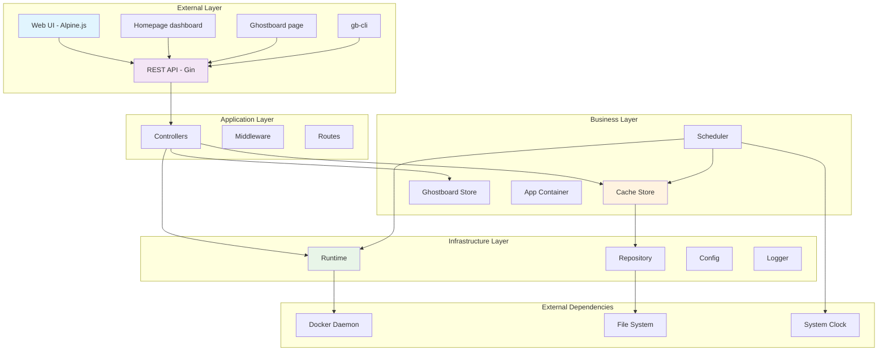
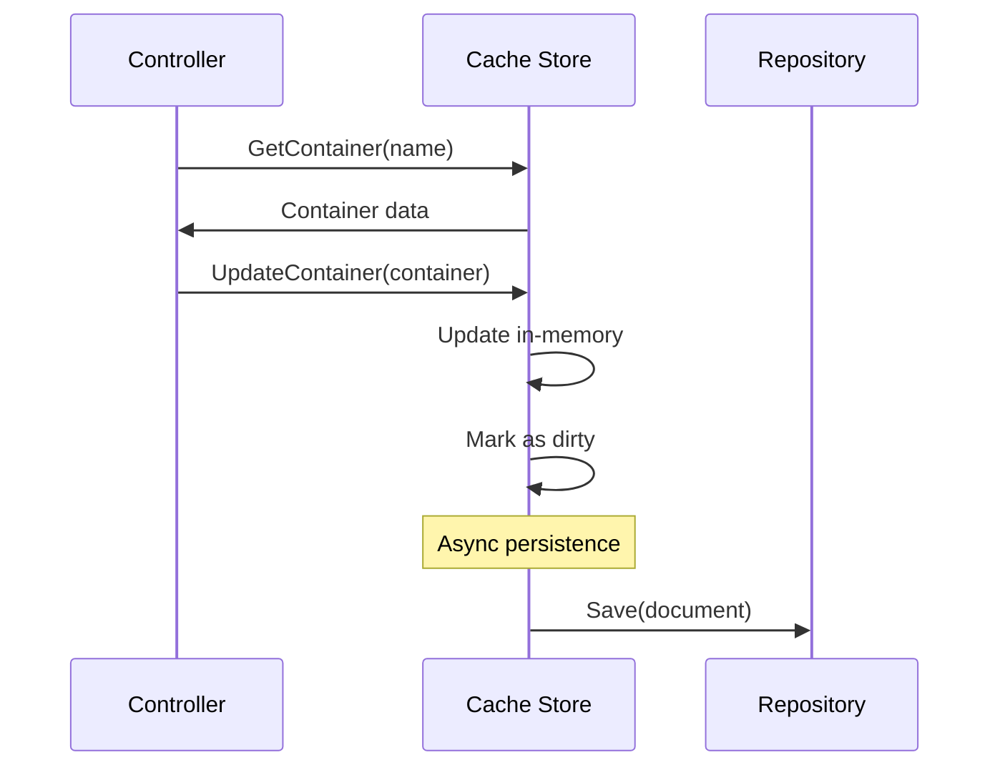
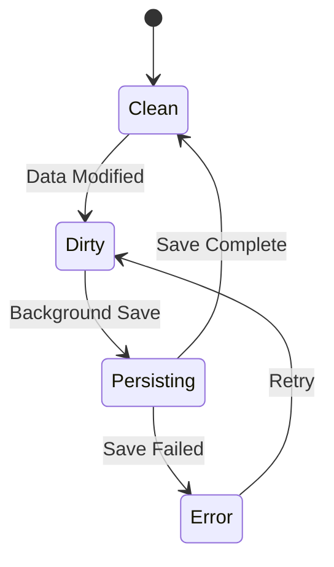
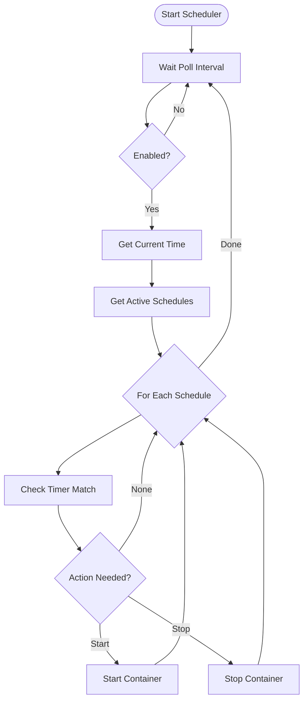
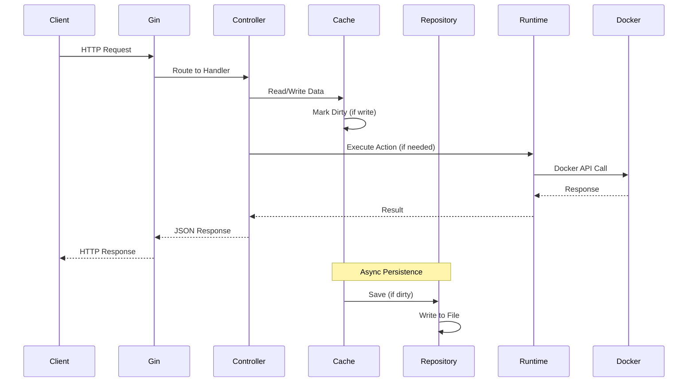
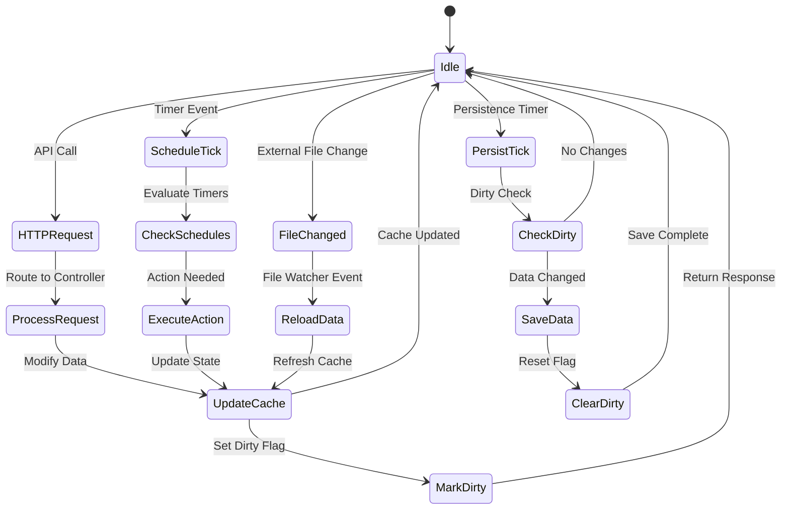

# Architecture & Design Patterns

## System Architecture Overview

GoSpin follows a modular, interface-driven architecture that prioritizes testability, maintainability, and extensibility.

### High-Level Architecture



## Design Principles

### 1. Separation of Concerns
Each package has a single, well-defined responsibility:
- **Controllers**: Handle HTTP requests and responses
- **Cache**: Manage in-memory data with persistence tracking
- **Runtime**: Abstract container lifecycle operations
- **Repository**: Handle data persistence and file operations
- **Scheduler**: Time-based automation logic

### 2. Dependency Inversion
High-level modules don't depend on low-level modules. Both depend on abstractions.

```go
// High-level module (Controller) depends on abstraction
type ContainerController struct {
    store   cache.AppStore          // Interface
    runtime runtime.ContainerRuntime // Interface
}

// Low-level modules implement interfaces
type DockerRuntime struct{} // Implements ContainerRuntime
type MemoryRuntime struct{} // Implements ContainerRuntime
```

### 3. Interface Segregation
Interfaces are kept minimal and focused:

```go
// Focused interface for runtime operations
type ContainerRuntime interface {
    Start(name string) error
    Stop(name string) error
    IsRunning(name string) (bool, error)
}

// Separate interface for data operations
type Repository interface {
    Load() (*DataDocument, error)
    Save(*DataDocument) error
    StartWatching(callback func()) error
}
```

### 4. Single Responsibility
Each component has one reason to change:
- **Cache**: Data storage and dirty tracking
- **Scheduler**: Time-based execution
- **Runtime**: Container operations
- **Repository**: File persistence

## Core Patterns

### 1. Repository Pattern

**Purpose**: Abstract data access and provide a uniform interface for data operations.

**Implementation**:
```go
type Repository interface {
    Load() (*DataDocument, error)
    Save(*DataDocument) error
    StartWatching(callback func()) error
    StopWatching() error
}

type JSONRepository struct {
    filePath string
    watcher  *fsnotify.Watcher
    // ...
}
```

**Benefits**:
- Easy to test with mock implementations
- Can switch storage backends (JSON → SQL → NoSQL)
- Centralizes data access logic
- Enables file watching for external changes

### 2. Cache-Aside Pattern

**Purpose**: Improve performance by keeping frequently accessed data in memory.

**Flow**:


**Implementation**:
```go
type Store struct {
    document *DataDocument
    dirty    bool
    mu       sync.RWMutex
}

func (s *Store) UpdateContainer(container *Container) {
    s.mu.Lock()
    defer s.mu.Unlock()
    
    s.document.Containers[container.Name] = container
    s.dirty = true // Triggers async persistence
}
```

### 3. Factory Pattern

**Purpose**: Create runtime implementations based on configuration.

**Implementation**:
```go
func NewRuntimeFromConfig(runtimeType string, store cache.AppStore) (ContainerRuntime, error) {
    switch runtimeType {
    case "docker":
        client, err := client.NewClientWithOpts(
            client.FromEnv,
            client.WithAPIVersionNegotiation(),
        )
        if err != nil {
            return nil, fmt.Errorf("failed to create Docker client: %w", err)
        }
        return &DockerRuntime{client: client, store: store}, nil
        
    case "memory":
        return &MemoryRuntime{store: store}, nil
        
    default:
        return nil, fmt.Errorf("unsupported runtime type: %s", runtimeType)
    }
}
```

**Benefits**:
- Easy to add new runtime implementations
- Configuration-driven runtime selection
- Enables testing without Docker dependency

### 4. Observer Pattern (File Watching)

**Purpose**: Automatically reload configuration when external changes occur.

**Implementation**:
```go
func (r *JSONRepository) StartWatching(callback func()) error {
    watcher, err := fsnotify.NewWatcher()
    if err != nil {
        return err
    }
    
    go func() {
        for {
            select {
            case event := <-watcher.Events:
                if event.Op&fsnotify.Write == fsnotify.Write {
                    callback() // Notify of changes
                }
            case err := <-watcher.Errors:
                log.WithError(err).Error("File watcher error")
            }
        }
    }()
    
    return watcher.Add(r.filePath)
}
```

### 5. Strategy Pattern (Runtime Implementations)

**Purpose**: Switch between different container runtime strategies.

```go
// Strategy interface
type ContainerRuntime interface {
    Start(name string) error
    Stop(name string) error
    IsRunning(name string) (bool, error)
}

// Docker strategy
type DockerRuntime struct {
    client docker.APIClient
    store  cache.AppStore
}

// Memory strategy (for testing)
type MemoryRuntime struct {
    containers map[string]bool
    store      cache.AppStore
}
```

## Component Deep Dive

### Cache Store Architecture

```go
type Store struct {
    // Core data
    document *DataDocument
    
    // State tracking
    dirty    bool
    lastSave time.Time
    
    // Concurrency control
    mu sync.RWMutex
    
    // Dependencies
    repository Repository
    logger     *logrus.Entry
}
```

**Key Features**:
- **Thread-safe**: Uses RWMutex for concurrent access
- **Dirty tracking**: Only persists when changes occur
- **Optimistic locking**: Uses timestamps to detect conflicts
- **Event-driven**: Reloads automatically on file changes

**Dirty Tracking Flow**:


### Scheduler Architecture

```go
type PollingScheduler struct {
    store        cache.AppStore
    runtime      runtime.ContainerRuntime
    pollInterval time.Duration
    timezone     *time.Location
    enabled      bool
    stopCh       chan bool
    logger       *logrus.Entry
}
```

**Scheduling Algorithm**:


**Time Handling**:
```go
func (s *PollingScheduler) shouldExecuteTimer(timer *Timer) (action string) {
    now := time.Now().In(s.timezone)
    weekday := int(now.Weekday())
    
    // Check if today is scheduled
    if !contains(timer.Days, weekday) {
        return "none"
    }
    
    // Parse start and stop times
    startTime, _ := time.Parse("15:04", timer.StartTime)
    stopTime, _ := time.Parse("15:04", timer.StopTime)
    
    // Create today's schedule times
    todayStart := time.Date(now.Year(), now.Month(), now.Day(),
        startTime.Hour(), startTime.Minute(), 0, 0, s.timezone)
    todayStop := time.Date(now.Year(), now.Month(), now.Day(),
        stopTime.Hour(), stopTime.Minute(), 0, 0, s.timezone)
    
    // Determine action based on current time
    if now.After(todayStart) && now.Before(todayStop) {
        return "start"
    } else {
        return "stop"
    }
}
```

### Runtime Abstraction

**Docker Runtime Implementation**:
```go
type DockerRuntime struct {
    client docker.APIClient
    store  cache.AppStore
    logger *logrus.Entry
}

func (d *DockerRuntime) Start(name string) error {
    // 1. Get container from store
    container := d.store.GetContainer(name)
    if container == nil {
        return ErrContainerNotFound
    }
    
    // 2. Check if already running
    running, err := d.IsRunning(name)
    if err != nil {
        return err
    }
    if running {
        return nil // Already running
    }
    
    // 3. Start container via Docker API
    err = d.client.ContainerStart(context.Background(), name, types.ContainerStartOptions{})
    if err != nil {
        return fmt.Errorf("failed to start container %s: %w", name, err)
    }
    
    // 4. Update store state
    container.Running = true
    d.store.UpdateContainer(container)
    
    d.logger.WithField("container", name).Info("Container started")
    return nil
}
```

**Memory Runtime (Testing)**:
```go
type MemoryRuntime struct {
    containers map[string]bool
    store      cache.AppStore
    mu         sync.Mutex
}

func (m *MemoryRuntime) Start(name string) error {
    m.mu.Lock()
    defer m.mu.Unlock()
    
    container := m.store.GetContainer(name)
    if container == nil {
        return ErrContainerNotFound
    }
    
    // Simulate container start
    m.containers[name] = true
    container.Running = true
    m.store.UpdateContainer(container)
    
    return nil
}
```

### Ghostboard Store

**Design** (`internal/ghostboard`):
- Boards live in one `Store` guarded by a mutex. Each board keeps its text, a revision
  counter, the last update time, its open event streams and the pending idle-clear timer.
- `Update` is a no-op when the text is unchanged, so a typing pause does not bump the revision.
  Otherwise it stores the text, increments the revision and fans an `Event` out to every
  subscriber. Subscribers get a buffered channel (16 events): a slow stream drops intermediate
  events and converges on the next full snapshot, which always carries the whole text.
- The text is dropped `ghostboard.clear_delay_secs` after the last write **or** the last
  subscriber leaving, whichever happens last. Every schedule increments a generation counter
  captured by the timer, so a tick that fires while a write re-arms the clear cannot empty the
  fresh text.
- `StartPersistence` flushes dirty boards to a dedicated JSON file every
  `ghostboard.persist_interval_secs` (empty boards are pruned) and flushes once more on shutdown.

**PIN gate** (`internal/ghostboard/auth.go`):
- The boards named in `ghostboard.private_boards` are protected by one shared PIN, for reading and
  writing. The list is configuration, so a board is private before it is ever written and no lock
  state needs to be persisted; every other board stays public.
- The PIN itself is never stored: `ghostboard.pin_hmac` holds `HMAC-SHA256(pin_secret, pin)`, which
  `gb-cli pin-hash` prints. Verification recomputes the digest and compares it with
  `hmac.Equal`, so a wrong PIN leaks neither its length nor the matched prefix. Without the secret
  a copy of the configuration file cannot be brute-forced, and changing the secret invalidates
  every digest and every open session at once.
- `Authenticator.Unlock` trades a PIN for a stateless session token
  (`v1.<expiry>.<hmac>`): the session survives a restart because it only carries its expiry and a
  signature. It throttles failures per client address with a lockout that doubles every further
  batch of `pin_max_attempts` failures, capped at an hour, keyed on the connection address rather
  than on `X-Forwarded-For` so a spoofed header cannot bypass it.
- `middleware.GhostboardPIN` gates the route group: a private board needs the `gb_pin_session`
  cookie (browsers, `EventSource` and `sendBeacon` cannot set a header) or an
  `Authorization: Bearer` token (scripts and `gb-cli`). A `nil` authenticator means no PIN is
  configured and every board is public.

**HTTP surface** (`internal/api/route/ghostboard_route.go` and
`internal/api/controller/ghostboard_controller.go`):
- `GET`/`POST /ghostboard/:board` — JSON board state; a write accepts a JSON body, a form field
  or the raw text.
- `GET /ghostboard/:board/events` — Server-Sent Events stream with the initial snapshot, every
  change and a keep-alive comment; it bypasses gzip and the per-request timeout.
- `GET`/`POST /api/boards/:board` — plain-text surface for CLIs; `POST` stores the raw body byte
  for byte, rejects invalid UTF-8 with `400` and answers `204 No Content`.
- `POST`/`DELETE /ghostboard/:board/unlock` — the PIN is traded for a session token, returned in
  the body and set as an HttpOnly, `SameSite=Strict` cookie (`session_ttl_secs`, `Secure` when the
  request arrived over HTTPS); `DELETE` expires the cookie. The route is registered without the
  gate, since it is how a session is obtained.
- `ui/ghostboard.html` and `ui/assets/ghostboard.js` render one independent board per
  `/ui/ghostboard/<board>` path. The page loads the board state before opening the event stream,
  so a private board shows the lock form instead of a stream that would retry forever, and a `401`
  while saving brings the form back without dropping the text typed locally.

**CLI** (`cmd/board`, client in `internal/boardclient`):
- `gb-cli` is a thin HTTP client of `/api/boards/:board`, so it works locally, in a
  container or against a remote host without touching the persistence file. `add` is a read
  followed by a write; `set`, `read`, `upload` and `download` map to one request each.
- `follow` consumes `/ghostboard/:board/events` with a client that carries no overall timeout (the
  stream stays open until Ctrl-C) and prints every revision, so the CLI shows the same live
  updates as the web page. The stream is read line by line without a fixed buffer: an event carries
  the whole board, whose size the server already bounds with `ghostboard.max_text_bytes`, so a
  client-side cap could only disagree with that limit.
- The configuration is resolved in `internal/boardclient` (defaults, YAML file next to the
  executable or in `$XDG_CONFIG_HOME/ghostboard/config.yaml` / `~/.config/ghostboard/config.yaml`,
  `GO_SPIN_BOARD_*` environment) and the command-line flags are applied on top by `cmd/board`.
  `Config.Validate` runs on the effective values, so a flag always corrects a mistyped file entry;
  `--no-config` skips every file and `ConfigPaths` lists the candidates.
- `config` prints the effective configuration, the file that was read and (with `--paths`) every
  candidate, without contacting the server, which makes a wrong URL or an unused file visible
  immediately. It also reports the keys the CLI does not understand and the environment variables
  that replaced a file value, so a mistyped key never looks like a default. `version`, `completion`
  and `config` deliberately run before the validation and never touch the network.
- `read --stat` and `read --json` use the JSON board API (`/ghostboard/:board`) because only that
  route carries the revision and the update time; every other read uses the plain-text route. The
  CLI turns the zero update time of a board that was never written into an absent field, so a
  consumer never sees a timestamp in year 1.
- Text and JSON never share stdout: `download -` and `follow` reject `--json`, `read --json`
  rejects `--stat`, and `download` rejects `-o` together with a file argument. These are reported
  as misuse (exit code `2`), the same code the CLI uses for a negative `--retry`, a non-positive
  `--timeout` or a text given both as an argument and with `-f`.
- The client retries transient failures (`429`, `502`, `503`, `504` and transport errors) with an
  exponential backoff and can send extra headers (`--header`, `GO_SPIN_BOARD_TOKEN` as a Bearer
  token), for a GoSpin instance behind an authenticating proxy.
- A private board answers `401` until the client unlocks it: `internal/boardclient` posts the PIN
  to `/ghostboard/:board/unlock` once per command, keeps the returned token and sends it as a
  bearer token, so the PIN itself travels once and is never retried after a rejection. The PIN
  comes from `--pin`, `GO_SPIN_BOARD_PIN` or the `pin` key of the configuration file, which is
  never printed by `config`. `gb-cli pin-hash` prints the `ghostboard.pin_hmac` value of a PIN,
  reading the secret from `GO_SPIN_GHOSTBOARD_PIN_SECRET`.
- Failures are typed: `EndpointError` (a 404 on a board route), `BoardNameError` and `misuseError`
  map to the dedicated exit codes `3`, `4` and `2`, so a script can tell a wrong URL, a wrong board
  name and a command line mistake from a generic error.
- `edit` round-trips the board through `$VISUAL`/`$EDITOR` and writes only when the temporary file
  changed; `completion` renders bash, zsh and fish scripts from the command and flag tables in
  `cmd/board/completion.go`.
- Board names are validated with `ghostboard.ValidateBoardName` before a request is made, so a
  malformed name never reaches the server.

### Homepage and Actions

**Design** (`internal/api/controller/homepage_controller.go`):
- `GET /homepage` reloads `config/homepage.yaml` on every request through
  `config.LoadHomepageConfig`, which returns the parsed sections plus a hash of the file. The page
  polls the endpoint, compares the hash with the one it rendered and re-renders only when the file
  changed, so editing the YAML is enough to publish new services, bookmarks or settings.
- The response embeds the build metadata (`version`, `buildTime`, `gitCommit`, `goVersion`) as
  top-level fields taken from `internal/version`. A `version` key written in the YAML is ignored:
  what the binary was built with always wins.
- Sections missing from the file are returned as empty arrays, so a minimal `homepage.yaml` still
  renders and an empty `actions:` list produces no buttons instead of an error.

**Actions** (`internal/api/controller/actions_controller.go`):
- The controller is a server-side HTTP proxy. `config/actions.yml` holds the technical definition
  (`method`, `url`, headers, body) and is optional: a missing file yields an empty action set. The
  parsed file is cached behind a `sync.RWMutex` and re-read on the first request after a failed
  startup load, so a syntax error fixed at runtime recovers without a restart.
- `POST /homepage/action` accepts `{"actionName": "..."}`, resolves the name and performs the
  request server-side with `data.actions_timeout_seconds`. Both modes wait for the target; they
  differ in what comes back, and `mode` always reports which one ran: `async` (default) returns the
  upstream status only, `sync` returns the status plus the body, capped at 1 MB.
- `LogDanglingReferences` runs at startup and warns about actions referenced in `homepage.yaml`
  but absent from `actions.yml`, which would otherwise only surface as a `404` on click.

### Cosmos Integration

**Design** (`internal/cosmos`):
- `Client.FetchRoutes` calls the Cosmos routes API with the configured bearer token, and
  `FilterValidRoutes` drops the entries that do not map to a usable container target.
- `ImportService.ImportContainers` turns the remaining routes into containers, skips the names that
  already exist in the store and reports `ImportResult`
  (`total_fetched`, `filtered`, `imported`, `skipped_existing`, plus the name and error lists).
- The path is exposed by `POST /containers/import`. When `misc.cosmos_base_url` or
  `misc.cosmos_token` is empty the handler answers `503` with a JSON error instead of failing
  silently, so the dashboard can render a usable message.
- The import is a one-shot reconciliation: it never removes containers that disappeared from
  Cosmos. Deletions stay an explicit action of the operator.

## Extension Points

### Adding New Runtime Types

1. **Create Runtime Implementation**:
```go
type KubernetesRuntime struct {
    client kubernetes.Interface
    store  cache.AppStore
}

func (k *KubernetesRuntime) Start(name string) error {
    // Kubernetes-specific implementation
}
```

2. **Update Factory**:
```go
func NewRuntimeFromConfig(runtimeType string, store cache.AppStore) (ContainerRuntime, error) {
    switch runtimeType {
    case "docker":
        return NewDockerRuntime(store)
    case "memory":
        return NewMemoryRuntime(store)
    case "kubernetes":
        return NewKubernetesRuntime(store)
    // ...
    }
}
```

### Adding New Storage Backends

1. **Implement Repository Interface**:
```go
type PostgresRepository struct {
    db *sql.DB
}

func (p *PostgresRepository) Load() (*DataDocument, error) {
    // Load from PostgreSQL
}

func (p *PostgresRepository) Save(*DataDocument) error {
    // Save to PostgreSQL
}
```

2. **Update Configuration**:
```yaml
data:
  backend: "postgres"  # json, postgres, mongodb, etc.
  connection_string: "postgres://..."
```

### Adding New Middleware

```go
func AuthMiddleware() gin.HandlerFunc {
    return func(c *gin.Context) {
        // Authentication logic
        token := c.GetHeader("Authorization")
        if !isValidToken(token) {
            c.AbortWithStatus(http.StatusUnauthorized)
            return
        }
        c.Next()
    }
}

// In route setup
r.Use(middleware.AuthMiddleware())
```

## Testing Architecture

### Test Strategy Layers

```mermaid
pyramid TB
    title Testing Pyramid
    
    subgraph "E2E Tests"
        API["API Integration Tests"]
        UI["UI and route tests (httptest)"]
    end
    
    subgraph "Integration Tests"
        HTTP["HTTP Handler Tests"]
        DOCKER["Docker Runtime Tests"]
        FILE["File System Tests"]
    end
    
    subgraph "Unit Tests"
        LOGIC["Business Logic"]
        UTILS["Utilities"]
        MOCK["Mock Implementations"]
    end
```

### Test Patterns

**Table-Driven Tests**:
```go
func TestContainerController_CreateContainer(t *testing.T) {
    tests := []struct {
        name           string
        input          Container
        existingData   *DataDocument
        expectedStatus int
        expectedError  string
    }{
        {
            name:           "valid new container",
            input:          Container{Name: "nginx", Active: true},
            existingData:   &DataDocument{Containers: make(map[string]*Container)},
            expectedStatus: 201,
        },
        {
            name:           "duplicate container name",
            input:          Container{Name: "nginx", Active: true},
            existingData:   &DataDocument{Containers: map[string]*Container{"nginx": {}}},
            expectedStatus: 400,
            expectedError:  "container already exists",
        },
    }
    
    for _, tt := range tests {
        t.Run(tt.name, func(t *testing.T) {
            // Test implementation
        })
    }
}
```

**Mock Interfaces**:
```go
type MockRuntime struct {
    StartFunc     func(string) error
    StopFunc      func(string) error
    IsRunningFunc func(string) (bool, error)
}

func (m *MockRuntime) Start(name string) error {
    if m.StartFunc != nil {
        return m.StartFunc(name)
    }
    return nil
}
```

**Integration Test Setup**:
```go
func setupTestApp(t *testing.T) *app.App {
    // Create temp directory for test data
    tmpDir := t.TempDir()
    
    // Create test configuration
    cfg := &config.Config{
        Data: config.DataConfig{
            FilePath: filepath.Join(tmpDir, "test.json"),
        },
        Misc: config.MiscConfig{
            RuntimeType: "memory", // Use memory runtime for tests
        },
    }
    
    // Initialize app with test dependencies
    return app.NewApp(cfg)
}
```

## Data Flow Architecture

### Request Processing Flow



### Event Flow Architecture



## Concurrency Model

Boot starts a fixed set of goroutines, and every one of them watches `app.BaseCtx`, the application
context created by `app.New`, so a single cancellation stops all the background work.

| Goroutine | Started from | Ends when |
| --------- | ------------ | --------- |
| Main HTTP server (`httpgrace`) | `cmd/server/main.go` | SIGTERM/SIGINT, drained within `server.shutdown_timeout_secs` |
| Waiting page server | `createWaitingServer` in `cmd/server/main.go` | SIGTERM/SIGINT through its own `httpgrace` instance |
| File watcher (`fsnotify`) | `App.StartWatchers` → `Repository.StartWatcher` | `BaseCtx` is cancelled |
| Data persistence loop | `App.StartWatchers` → `cache.StartPersistenceScheduler` | `BaseCtx` is cancelled, after a final flush |
| Ghostboard persistence loop | `App.StartWatchers` → `Store.StartPersistence` | `BaseCtx` is cancelled, after a final flush |
| Polling scheduler | `App.StartWatchers`, only when `data.scheduling_enabled` | `BaseCtx` is cancelled |
| Request handler | `net/http` | the handler returns |
| Event stream handler | `/ghostboard/:board/events` | the client disconnects or the context is cancelled |

Shutdown has two stages, and the order matters. The signal first reaches the `httpgrace` servers,
which stop accepting connections and drain the in-flight requests; `main` then returns and its
deferred `App.Shutdown` executes. That call cancels `BaseCtx`, flushes the ghostboard synchronously
(a cancelled persistence goroutine can no longer do it) and finally waits on the `persistDone`
channel, so the data document reaches disk before the process exits.

Shared state is guarded and copied, not passed around. `cache.Store` keeps the data document behind
a `sync.RWMutex` and `Snapshot` returns a deep copy, which is why controllers can read a consistent
document while another request mutates it. `ghostboard.Store` uses a `sync.Mutex` for the boards and
a separate `persistMu` for the file. Each event stream owns a 16-slot buffered channel, and a
subscriber that fills it loses the intermediate events instead of blocking the writer; that is safe
because every event carries the whole board text, so the next one converges to the current state.

## Key Design Decisions

Each row is a trade-off taken deliberately; the ADR column points at the record that carries the
reasoning.

| Decision | Benefit | Trade-off | Record |
| -------- | ------- | --------- | ------ |
| Async persistence behind a dirty flag | API responses never wait for the disk | up to `data.persist_interval_secs` of writes are lost on a hard kill | [ADR-0006](ADRs/0006-json-persistence-dirty-cache.md) |
| JSON data file with an in-memory cache | nothing to deploy; the file is readable and editable by hand | the whole document is rewritten per flush, and there is a single writer | [ADR-0006](ADRs/0006-json-persistence-dirty-cache.md) |
| File watching with optimistic locking | external edits apply without a restart | depends on the file system delivering `fsnotify` events (no events on some network mounts) | [ADR-0006](ADRs/0006-json-persistence-dirty-cache.md) |
| Interfaces at the runtime and data boundaries | tests run without Docker through the memory runtime | one more indirection between a handler and the SDK | [Design Principles](#design-principles) |
| Polling scheduler | no stored timer state, so a restart needs no reconciliation | an action fires on the first tick after its window, not on the exact second | [ADR-0001](ADRs/0001-polling-scheduler.md) |
| Server-Sent Events for the ghostboard | live updates over plain HTTP, no login and no polling | one long-lived connection per open page, and the hub lives in the process, so it does not scale out | [ADR-0002](ADRs/0002-ghostboard-sse.md) |
| Actions executed by the server | the target URL, headers and body never reach the browser | an action can only do what `actions.yml` describes, and the file is parsed on every execution | [ADR-0003](ADRs/0003-homepage-yaml-actions-proxy.md) |
| `gb-cli` built as a separate binary | the CLI carries no server code | two binaries to build, version and document | [ADR-0005](ADRs/0005-gb-cli-separate-binary.md) |
| Taskfile as the only build front-end | one file defines build, lint, test and release steps | `task` becomes a prerequisite for building | [ADR-0007](ADRs/0007-taskfile-build-frontend.md) |

## Performance and Resources

### Measured characteristics

The figures below come from the demo instance behind the screenshots: memory runtime, 8 containers,
2 groups, 2 schedules, on a Raspberry Pi 4 with Go 1.25.6 and loopback HTTP. They show the shape of
the cost rather than a benchmark — CI does not measure them, so re-measure before quoting them in a
sizing discussion.

| Measurement | Value |
| ----------- | ----- |
| Resident memory, idle 12 s after boot | ≈ 19 MB, 8 OS threads |
| `GET /containers` (read served from the cache) | 1.5–3.5 ms |
| `GET /homepage` (re-reads and hashes `homepage.yaml`) | 2.5–6 ms |
| `GET /runtime/system-stats` (first call, then warm) | ≈ 115 ms, then 1.5–2 ms |

The first `system-stats` call samples the host's disk usage from `data.system_monitor_mount_point`;
later calls reuse the sampling interval. `GET /homepage` re-reads the YAML file and computes its
SHA-256 on every request, which is what keeps the hot-reload hash cheap and always correct. Container
start and stop latency is the Docker daemon's, not GoSpin's: the handler waits for the runtime call.

### Scheduling precision

The scheduler polls, so an action is applied on the first tick after its window opens or closes. With
the default `data.scheduling_poll_interval_secs: 30` a container can start up to 30 seconds after its
scheduled time. A shorter interval buys precision at the cost of runtime calls on every tick.

### Persistence cost

Both persistence loops are ticker-driven and skip a tick when nothing changed:
`data.persist_interval_secs: 5` for the document, `ghostboard.persist_interval_secs: 2` for the
boards. A flush rewrites the file through a temporary file, an `fsync` and a rename, so its cost
follows the size of `data/config.json` rather than the number of changes.

### Minimum and recommended footprint

| Resource | Minimum | Recommended |
| -------- | ------- | ----------- |
| CPU | 1 shared core | 2 cores |
| RAM | 32 MB for the process | 64 MB |
| Disk | 100 MB (binary, UI assets, data file) | 200 MB with logs |
| Network | 1 Mbps | 10 Mbps |

The container runtime is not included: GoSpin talks to the daemon over `/var/run/docker.sock` and
does not bundle one, so add the memory of the containers you manage.

This architecture documentation provides a comprehensive view of the system's design patterns, component interactions, and extension points. It serves as a guide for developers to understand the codebase structure and make informed decisions when adding new features or modifications.